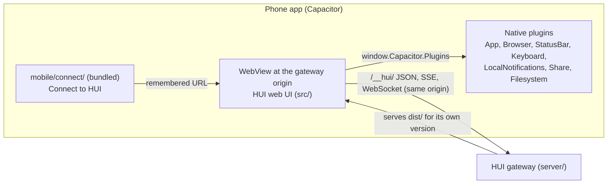
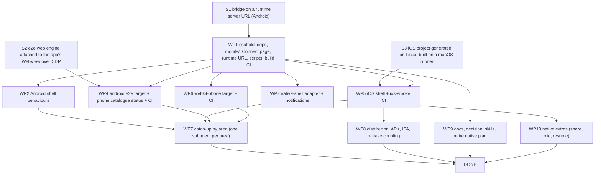

# Plan: HUI's phone apps as one Capacitor shell around the web UI

Status: a plan, nothing built yet. It replaces `docs/native-android-plan.md`, whose fully native Compose app the owner
dropped on 2026-11-09 (SPEC.md, "The phone apps wrap the web UI"). It was checked against `main` at `c7841893`,
Capacitor `8.6.0`, tester-army/e2e `0.21.3`, `@e2e-dev/web` `0.15.3` (which can attach to a browser over CDP) and
`@e2e-dev/mobile` `0.12.3`. A statement marked "(spike Sn)" is not proven yet; wave 0 settles it before work depends on
it. Times are estimates, not measurements, unless a row says it was measured.

The work is written to be run as a goal by an orchestrating agent that hands independent work packages to parallel
subagents (section 6). Every package names the files it owns, the contracts it may rely on, and the evidence that
closes it.

## 0. Summary

- **One UI, three surfaces.** The Android and iOS apps are Capacitor shells that load the connected gateway's own web
  UI, as the Electron app does (`desktop/main.cjs`). Every web feature reaches both phones in the PR that builds it,
  so "every change ships on the phones too" costs nothing beyond the phone layout the web already has.
- **The shell adds only what a browser can't:** remembering the gateway, the system back button, opening other
  origins in the system browser, downloads, the status bar, system notifications, the share sheet, the microphone
  permission, reconnecting on resume. The web UI reaches those through one typed adapter, `src/lib/native-shell.ts`,
  which reads the bridge Capacitor injects (`window.Capacitor`). `src/` never imports `@capacitor/*`.
- **Fast iteration, not everything local.** You and the agents iterate on the web UI in a browser (Vite, seconds) and
  touch the emulator only when the shell changes. CI runs the heavy proof on every PR: the shared suite inside the
  Android app's WebView on a Linux emulator, the suite in mobile WebKit as the iPhone's proxy, and an iOS build with
  a simulator smoke test on a macOS runner. Nobody needs a Mac day to day.
- **Effort:** about 1 to 1.5 weeks of wall-clock time with parallel subagents. The critical path is spike S1, then
  the scaffold, then the Android e2e target, then the parallel catch-up by area.

### Decisions at a glance

| Question | Decision |
|---|---|
| Framework | Capacitor 8 (`@capacitor/core`, `cli`, `android`, `ios`) and the official plugins listed in 8 |
| What the app loads | The gateway's served UI at the address the user connects to; never a bundled copy of the UI |
| Where it lives | `mobile/`: `capacitor.config.ts`, `mobile/connect/` (the bundled Connect page), `mobile/android/`, `mobile/ios/` |
| Web ↔ native seam | `src/lib/native-shell.ts`: feature detection plus typed calls over `window.Capacitor.Plugins` |
| App ids | `dev.hui.app` (Android release and iOS), `dev.hui.app.debug` (Android debug) |
| Local loop | Browser for UI; `npm run mobile -- android` (build, install, launch on the emulator) for shell changes |
| CI targets | `web` (unchanged), `android` (the suite in the app's WebView over CDP), `webkit-phone` (Playwright WebKit at an iPhone size), `ios-smoke` (macOS runner) |
| Lockstep | The catalogue gains a `phone` status. A use case required on the web is required on the phone unless excluded with a SPEC anchor; the `android` and `webkit-phone` targets prove it |
| Distribution | Android: a signed APK on GitHub Releases (Obtainium). iOS: an unsigned IPA plus a SideStore source, or TestFlight (owner decision O1) |
| Agents | Subagents on `opencode-go/deepseek-v4.1-flash` implement; reviewers run on another model family; one orchestrator owns merges |

## 1. Architecture



- **The Connect page** (`mobile/connect/`, plain TypeScript and HTML built by Vite into Capacitor's `webDir`) is the
  only bundled web content. It asks for the address and checks `GET /__hui/update` ("This address doesn't answer as a
  HUI gateway." otherwise, the strings of SPEC.md "The iOS app connects to one gateway"). Then it asks the native side
  to remember the address and load it. A `huiGatewayUrl` launch extra (Android) or launch argument (iOS) skips it, for
  tests and `npm run mobile`.
- **Loading the gateway.** The shell points Capacitor's server URL at the gateway at runtime, before the bridge
  exists: on Android, `EmbeddedConfig` loads the generated `capacitor.config.json` from the assets and sets
  `server.url` on the `CapConfig` that `BridgeActivity.load()` builds (spike S1); on iOS, `instanceDescriptor()` in
  a `CAPBridgeViewController` subclass. The bridge and plugins then work on that origin. A link to another origin
  leaves for the system browser through Capacitor's own launch intent, so no `allowNavigation` entry is needed and a
  page cannot navigate the shell off the gateway.
- **The UI is the gateway's.** Updating the gateway updates the phone's UI; the shell changes rarely. A shell older
  than the gateway expects shows the web's own update notice. `docs/api.md` gains a "Phone apps" note: same routes,
  same `x-hui` gate, same-origin WebSockets.
- **Reachability.** HTTPS through `tailscale serve` is the supported setup. Cleartext is allowed only for loopback
  and `10.0.2.2`, for tests (`adb reverse`). Plain HTTP to a tailnet address is owner decision O3.

## 2. Contracts frozen before the parallel waves

Wave 1 writes these down in `mobile/AGENTS.md` and nobody changes them without the orchestrator. They are what lets
packages run in parallel without editing each other's files.

| Contract | Value |
|---|---|
| Directory ownership | `mobile/android/**` (WP2), `mobile/ios/**` (WP5), `mobile/connect/**` (WP1, then WP2), `src/lib/native-shell.ts` and its callers (WP3), `e2e.config.ts`, `e2e/fixtures/hui.ts` and `e2e/fixtures/phone.ts` (WP4, then WP6), `.github/workflows/mobile*.yml` (WP4 adds `android`, WP5 adds `ios`, WP6 adds `webkit-phone`; one job each, so no shared lines), catalogue files (WP4, then the WP7 area owners) |
| Dependencies | Every npm and Gradle dependency the plan needs is installed in WP1 in one commit with `package-lock.json`. No later package touches `package.json` or the lockfile without the orchestrator |
| Adapter API | `src/lib/native-shell.ts` exports `nativeShell(): NativeShell \| null` with `platform: "android" \| "ios"`, `openExternal(url)`, `notify({ id, title, body, path })`, `share({ title, text, url })`, `setStatusBar({ dark: boolean })`, `onResume(callback)`, `onBack(callback): () => void`, `forgetGateway()`. It is `null` in a browser, so every caller keeps its web behaviour |
| Launch | Android: `am start -n dev.hui.app.debug/dev.hui.app.MainActivity --es huiGatewayUrl <url>` (honoured in debug builds only, so another app cannot redirect a released shell). iOS: `-HUIGatewayURL <url>`. Deep link `hui://open?path=<path>` on both |
| E2E target names | `web`, `android`, `webkit-phone`, `ios-smoke` |
| Scripts | `npm run mobile -- doctor \| emulator \| stop \| build \| test \| dev [--gateway <url>] [--fresh] [--no-gateway] \| screenshot <path> \| connect`, `npm run mobile:build` (the Connect page alone, no Android toolchain needed) |
| Ports | `E2E_PHONE_PORT` (default 47400) for the gateway the emulator reaches through `adb reverse`; `E2E_CDP_PORT` (default 9333) for the forwarded WebView DevTools socket |

## 3. How iteration stays fast

| Change | Where you check it | Time |
|---|---|---|
| Web UI (most work) | `npm run dev` in a desktop browser at the phone size, or the Browser tool's phone emulation; `npm run e2e -- <file>` | seconds |
| The same change on a real phone layout | `npm run mobile -- dev` once, then reload: the app loads the dev gateway, so later UI edits need only a reload | about 10 s the first time, then a reload (measured: 5 s warm on this machine) |
| Shell code (`mobile/android`) | `npm run mobile -- dev`: incremental Gradle, install, launch | under 20 s (measured: about 5 s warm) |
| The shared suite on Android | Push the package branch: CI runs `android` sharded on Linux emulators | about 10 to 20 min (spike S4) |
| iPhone rendering | CI `webkit-phone` on Linux; locally `npm run e2e:webkit-phone -- <file>` when needed | minutes |
| iOS shell | CI `ios-smoke` on a macOS runner, with screenshots as artifacts; the owner's MacBook only for iOS-only bugs | about 10 to 15 min (spike S3) |

The rule for agents: run locally only the narrowest check of what you changed, push the package branch, and wait for
its CI run (`gh run watch`). Read the failure from the job's artifacts (`trace.md`, screenshots) instead of
reproducing the whole matrix locally. WP1 adds `push: branches: ["mobile/**"]` to the test, E2E and mobile
workflows, so a package branch gets the full CI on every push without a pull request of its own (section 6).

## 4. Work packages



Each package lists: what it does, the files it owns, what it can rely on, how it proves it is done, and where the
proof runs.

### Wave 0: spikes (parallel, throwaway branches, no PR)

| Spike | Question | Proof | If it fails |
|---|---|---|---|
| S1 | Does a Capacitor 8 Android app started on the Connect page load a gateway URL chosen at runtime, with `window.Capacitor.Plugins.App` callable from the gateway's page, WebSockets and the service worker working, and the soft keyboard resizing the page? | A screenshot of HUI's session list in the app, plus a console log of a plugin call from the gateway origin | Load the gateway in a plain `WebView` inside our own small activity and keep only the plugins we need, wired by hand (`@JavascriptInterface`); the adapter contract stays the same |
| S2 | Can `@e2e-dev/web`'s `connect.cdpEndpoint` drive the app's WebView? `adb forward tcp:9333 localabstract:webview_devtools_remote_<pid>`, then attach, reuse the existing page (no new contexts), and run one existing test (`e2e/tests/sess/*`) green | One test passing with the trace showing the app's WebView | Drive the WebView through agent-device's accessibility tree for a smoke subset, and rely on `webkit-phone` plus Chromium at a phone size for the suite |
| S3 | Does `npx cap add ios` work on Linux (Swift Package Manager, no CocoaPods), and does a `macos-latest` runner build it for the simulator and screenshot it with agent-device? | A CI artifact screenshot of the Connect page | Generate the iOS project on the macOS runner in CI, with the owner's MacBook as fallback |
| S4 | On GitHub's Linux runners with KVM: emulator boot, minutes per shard for the suite in the WebView, flakes over 5 runs | Job timings | Fewer shards per PR and the whole suite nightly; record it as owner decision O2 |

S1 and S2 share the emulator, so S2 starts from S1's APK. S3 and S4 are independent of both.

**Results (2026-11-09, all four green).** Measured on this machine, CI and the owner's toolchain:

- **S1, green.** `CapConfig.Builder.setServerUrl` set in an override of `BridgeActivity.load()` scopes Capacitor's
  document-start script — the bridge and every plugin — to the gateway's origin, and a plugin call from the gateway's
  page answers. REST with `x-hui`, the session WebSocket (streamed deltas, heartbeats) and, on the production build,
  the service worker (offline shell after the gateway stopped) all work in the WebView, and the soft keyboard resizes
  the page so the composer stays above it. Two caveats shaped WP1: a live bridge's server URL cannot change, so the
  Connect page hands its address to a small local plugin that saves it and recreates the activity (~1 s); and the
  gateway refuses the preflight of a cross-origin `fetch`, so the probe uses Capacitor's built-in `CapacitorHttp` on a
  device and falls back to `fetch` in a browser (no gateway change). The devShell needs build-tools 35.0.0 **and**
  36.0.0 and **JDK 21**.
- **S2, green with shims.** `connect.cdpEndpoint` alone cannot attach: Playwright's `connectOverCDP` sends
  `Browser.setDownloadBehavior`, which a WebView refuses, and the persistent path expects a
  `defaultBrowserContextId` a WebView does not report. With `connect: { cdpEndpoint, reconnectEndpoint }` plus two
  shims in `e2e/fixtures/phone.ts`, real shared tests pass on the `android` target (CHAT-066 and SESS-018). The engine
  cannot create pages or contexts, so each test relaunches the app (~2–3 s), `pm clear` only before a page exists, and
  `platforms: ["web"]` does not filter the phone target out — WP4 must mark phone-only tests through the fixture.
  A phone-sized viewport must be declared on the target or the page is laid out at 1280×720.
- **S3, green.** `npx cap add ios` works on Linux (Swift Package Manager, no CocoaPods), and a `macos-latest` runner
  builds, installs, launches and screenshots the app with no Mac: 6m15s a job, Xcode 26.6 preinstalled, iOS 26.x
  runtimes only, simulator boot 92–120 s. A launch argument read through `UserDefaults` and applied by overriding
  `instanceDescriptor()` gives the shell its runtime URL, and the bridge is injected on that origin on iOS too.
- **S4, green.** KVM works on `ubuntu-latest`; cold boot 39 s, 6 s from a cached AVD snapshot; a single-emulator job
  is about 2.5 min. Two emulators per runner contend (boot +49%), so one emulator per shard, 4 shards. Wait on
  `sys.boot_completed` and `pm path android`, never on `init.svc.bootanim`, and cache the AVD (2.7 GB), not the SDK.

### WP1: scaffold (serial, one worker, about 1 day)

- Installs every dependency of section 8 in one commit.
- Adds `capacitor.config.ts` (appId `dev.hui.app`, `webDir: mobile/connect/dist`, Android path `mobile/android`, iOS
  path `mobile/ios`, `server.androidScheme: https`, WebView debugging in debug builds only) and `npx cap add android`
  output.
- Builds the Connect page with the gateway check and the remembered address. Implements the runtime server URL from
  S1, the `huiGatewayUrl` extra and `allowNavigation` for the gateway host.
- Replaces the Compose app from PR #458. It keeps that PR's flake shell (`devShells.android`, the FHS-wrapped
  agent-device), emulator scripts and screenshot procedure, renamed under `scripts/mobile.mjs` and
  `npm run mobile`. #458 closes in favour of the integration PR.
- Adds the `mobile / android-build` CI job (Gradle debug build), `push: branches: ["mobile/**"]` triggers on the test,
  E2E and mobile workflows (so package branches get CI without pull requests), and `mobile/AGENTS.md` with section
  2's contracts.
- Owns: `capacitor.config.ts`, `mobile/**`, `scripts/mobile.mjs`, `package.json`, `package-lock.json`, `flake.nix`,
  `.github/workflows/mobile.yml` (build job), the push triggers in `test.yml` and `e2e.yml`, `docs/map.md` rows, the boundary rule "`src/` never imports
  `@capacitor/*`" in `scripts/boundaries.test.mjs`.
- Done when: the emulator shows Connect to HUI, refuses a non-HUI address, then shows the fixture gateway's session
  list and a chat streaming `E2E_RICH`; `npm test` and `npm run typecheck` pass; the CI build job is green.
  Screenshots in the PR.

### Wave 1: parallel after WP1

**WP2 Android shell behaviours** (about 1 to 2 days). The system back button closes the web UI's dialog, drawer or
pane, then goes back in history, then leaves the app; the web exposes this through `onBack` (WP3 adds the adapter
half, WP2 the native half; they meet at the contract). Links to other origins open in the system browser. Downloads
(bot export, diagnostics) are saved through the system's download handling. The file chooser covers photos, files
and the camera. The status bar follows the theme, and the keyboard resizes the page without hiding the composer.
Owns `mobile/android/**`, `mobile/connect/**`. Proof: agent-device screenshots of each behaviour on the emulator, and
the `android` e2e target green on the use cases it touches once WP4 lands.

**WP3 Web-side adapter and notifications** (about 1 to 2 days). Adds `src/lib/native-shell.ts` per the contract,
with Vitest tests against a fake `window.Capacitor`. Then the callers:
- external links go through `openExternal`;
- a session that settles or starts waiting while the app is in the background posts a local notification whose tap
  opens it;
- dialogs, the drawer and the Work pane register with `onBack`;
- the status bar follows the theme;
- `onResume` triggers the existing reconnect checks.

In a browser every caller keeps its exact current behaviour. Owns `src/lib/native-shell.ts`, its tests, and the
smallest edits in the controllers and views that call it. It never touches `mobile/`. Proof: unit tests, `npm test`,
the web e2e suite unchanged, plus a notification screenshot on the emulator.

**WP4 The `android` e2e target and the phone status** (about 2 days, the critical path).
- Adds the `android` target to `e2e.config.ts`: the web engine attached over CDP to the debug app's WebView (S2),
  with the launcher's gateway on `E2E_PHONE_PORT`, reached through `adb reverse`.
- Adds `e2e/fixtures/phone.ts`: install, launch with the extra, forward the DevTools socket, clear state with
  `pm clear`. The fixture's existing web steps work unchanged, because the page is HUI's web UI.
- Adds `phone: Status` to every catalogue entry: `required` where the web is required and the case passes on
  `android`; an exclusion with a SPEC anchor for desktop-only, wide-layout and keyboard-only cases (recovered from
  `git show d921912b:e2e/catalogue/<area>.ts`, the old iOS reasons); otherwise `backlog` in `baseline.json`'s new
  `backlog.phone`.
- Extends `scripts/use-cases.test.ts` and `scripts/e2e-baseline-check.ts` to the phone status, with the rules the
  iOS version had: the backlog only shrinks, a new use case is required on both, and a changed one leaves both
  backlogs.
- Adds the `mobile / android-e2e` CI job: Linux, KVM, the emulator snapshot cached, sharded, `trace.md` and
  screenshots uploaded.

Owns `e2e.config.ts`, `e2e/fixtures/phone.ts`, `e2e/fixtures/hui.ts` (only the phone branch), `e2e/catalogue/**`,
`scripts/use-cases.test.ts`, `scripts/e2e-baseline-check.ts`, the `android-e2e` job. Proof: CI green with the
baseline recorded, and the backlog count in the PR.

**WP5 iOS shell and `ios-smoke`** (about 2 days). `npx cap add ios` (S3), the runtime server URL in a
`CAPBridgeViewController` subclass, `-HUIGatewayURL`, the `hui://` scheme, and the same Connect page. Adds the
`mobile / ios-smoke` job on `macos-latest`: build for the simulator, boot it, launch against the launcher's gateway,
use agent-device to check Connect, the session list and one chat, and upload screenshots. Notes the WKWebView limits
(service workers only on App-Bound Domains, so offline caching may be absent on iOS) in `mobile/AGENTS.md`. Owns
`mobile/ios/**` and the `ios-smoke` job. Proof: the CI job's screenshots in the PR. The owner checks it once on the
MacBook or the iPhone.

**WP6 The `webkit-phone` target** (about 0.5 to 1 day). A Playwright WebKit target at 390×844 with touch, on Linux, as
the iPhone's rendering proxy. It runs the whole suite and records its failures in the same phone backlog (a use case
is phone-required only when it passes on both `android` and `webkit-phone`). Owns the `webkit-phone` target lines in
`e2e.config.ts` (after WP4 merges, rebased on it) and its CI job. Proof: CI run and failure list.

**WP9 Docs and skills** (about 0.5 day, starts with WP1). The SPEC decision record, roadmap HUI-22 and this plan
landed with the plan's own PR; WP9 adds what the built shell needs:
- `docs/api.md`'s "Phone apps" note.
- The root `AGENTS.md` change discipline: "a user-visible change passes the `android` and `webkit-phone` targets".
- The visual-verification skill's Android procedure for the shell, plus an iOS procedure from CI artifacts.
- The PR template's Phone evidence section.

Owns those documents only. Proof: `git diff --check` and links checked.

### Wave 2: the catch-up, as wide as the backlog

**WP7 Phone backlog by area.** WP4 and WP6 record which use cases fail inside the app or in mobile WebKit. One
subagent per area (SHELL, SESS, CHAT, RICH, AGENT, WORK, BOARD, SET, PAGE, BOT, CALL: up to 11 at once) takes its
area's phone backlog to `required` or to an exclusion with a reason. It fixes the web UI's phone layout where a test
shows a real problem, and fixes a test that assumed the wide layout through the fixture's existing `hui.sessionList`
and `hui.phoneScreen` steps. Each owns its area's catalogue file, its `e2e/tests/<area>/` files and the `src/` views
of its area. A view two areas share is assigned to one of them by the orchestrator. Proof: the area's tests green on
`android` and `webkit-phone` in CI, and the backlog count down by that area's size.

**WP8 Distribution** (about 1 day, after WP5). A release-signed APK and an unsigned IPA built by `release.yml` and
`nightly.yml` from the validated commit and attached to the GitHub Release beside the `.tgz`. Android installs
through Obtainium; iOS through a SideStore source file or TestFlight (O1). `docs/guide.md` gets an "Install the phone
app" section. Owns those workflows' mobile steps and `scripts/sidestore-source.mjs`.

**WP10 Native extras** (parallel, about 1 day each, after WP3). The share sheet for a message or a file, the
microphone permission for GPT-Live calls in the WebView, and reconnecting after the OS suspends the app. Each one owns
its adapter method's callers and the native permission entries.

### Critical path and wall-clock

S1 (0.5 day) → WP1 (1 day) → WP4 (2 days) → WP7 (2 to 3 days, 11 in parallel). WP2, WP3, WP5, WP6 and WP9 run beside
WP4, and WP8 and WP10 beside WP7. About 6 to 8 working days if CI capacity keeps up (section 7).

## 4.5 Phone backlog, as measured

Every use case starts on the phone backlog; an area graduates a test file at a time, on evidence from a run inside the
Android app's WebView, and the backlog only shrinks. Measured on 2026-11-10, after the first catch-up slices:

| Area | Required | Backlog | Excluded |
|---|---|---|---|
| SHELL | 24 | 10 | 8 |
| SESS | 5 | 61 | 10 |
| CHAT | 0 | 76 | 8 |
| RICH | 15 | 31 | 5 |
| AGENT | 23 | 35 | 4 |
| WORK | 25 | 39 | 20 |
| BOARD | 0 | 48 | 3 |
| SET | 3 | 83 | 4 |
| PAGE | 0 | 24 | 1 |
| BOT | 19 | 49 | 6 |
| CALL | 0 | 25 | 1 |
| **All** | **114** | **481** | **70** |

What the catch-up learned, which the areas still to do can reuse:

- A test that reads the sidebar needs `hui.sessionList()` first on a phone: the drawer is closed, so rows, group headers and
  the toolbar are not on screen and every poll comes back empty.
- A control the design draws at every width needs no hover; a hover in a test only proves the desktop's gesture (and
  `webkit-phone` refuses `hui.peek`), so drop it rather than keep it.
- A test that calls `hui.wideScreen()` and then reads a wide-only surface (the Work pane's rail, maximize and resizer, the
  sidebar's collapse and resize) must be excluded on the phone: a WebView viewport override is not a phone screen.
- HTML5 drag reorder can pass through CDP mouse events while a finger cannot start it; exclude those rather than claim
  `required`.

### 4.6 Coverage before phone parity

The catalogue lists every user outcome; a use case is proven by one shared tester-army test that runs on each target, so
"proven on the phone" needs a test to exist first. Measured on 2026-11-10, that ordering exposed debt that predates the
phone work: of 665 use cases, the web proves 368 and **294 have no test on any platform** (main carried 301 when the
catalogue landed on 2026-10-21). The phone cannot prove what no test describes.

So the catch-up runs in two phases:

1. **Write, on the browser.** A green web test costs about 1.5 s (one Chromium per file); a green phone test costs about
   15 s, because the WebView has one page and no context, so the engine needs a relaunch per attempt. Three or four
   writers work different areas in parallel and verify only on `--target web`, where they also burn down the web backlog.
2. **Sweep, on the phone.** Once writing is done, one sweep per area with at most two emulators. Every test that reaches
   the emulator is already green in Chromium, so a failure there is a phone difference rather than an unfinished test.

`e2e/fixtures/phone.ts` carries `E2E_PHONE_REUSE=1`, which keeps the app's process alive for a whole file and counts
attempts for the identity the engine checks (instead of using the process id). It is off until the sweep measures what a
shared launch buys and what process-sharing costs.

## 5. Lockstep after this lands

- A user-visible web change runs on `web`, `android` and `webkit-phone` in the PR's CI. No phone-specific work is
  needed unless the phone layout breaks, which those targets show.
- A change under `mobile/` also runs `ios-smoke` and needs emulator screenshots in the PR.
- The catalogue's phone backlog only shrinks. A new use case is required on the web and the phone, or excluded with
  a reason and a SPEC anchor.

## 6. Orchestration

### One pull request

The whole plan ships as one pull request: #460, whose branch `danifdz/mobile-shell-plan` is the integration branch.
It stays a draft until the last wave is verified. Then its title becomes `feat: add the Android and iOS apps around
the web UI`, and the owner reviews and merges it.

- Each package works on its own branch, `mobile/<wpn>-<slug>`, cut from the integration branch's current head, in
  its own worktree. It opens no pull request: pushing it runs CI through the `push: mobile/**` triggers WP1 adds.
- When a package's evidence holds and its reviewer passes it, the orchestrator merges the branch into the
  integration branch with `git merge --no-ff`, one merge commit per package so the history reads by package. It
  runs the narrow checks that cover the merged paths and pushes. The integration PR's CI proves the merged whole.
- A later wave's branches are cut after the earlier wave is merged. A branch whose base moved merges the
  integration branch in before it is merged back. The orchestrator never force-pushes the integration branch.
- The PR description is the public half of the ledger. The orchestrator updates it after each merge: packages
  merged, backlog counts, screenshots (attached with `gh pr edit --body-file … --attach …`) and open proof gaps.

### Roles

- **Orchestrator** (the goal's own session): runs wave 0 and WP1 or hands them to one worker, freezes the contracts,
  spawns each wave, reviews every result against its acceptance evidence, merges package branches into the
  integration branch in dependency order, and keeps a ledger (package, branch, CI run, state, blocker) in the
  goal's conversation.
- **Workers:** `sessions_spawn` with `model: "opencode-go/deepseek-v4.1-flash"`, `thinking: "high"`,
  `worktree: true`, `runTimeoutSeconds: 3600`, `collect: true` for a wave launched from one codemode script. One
  package per worker and one branch per package; no pull request per package.
- **Reviewers:** the `reviewer` route on a different model family from DeepSeek, one per package branch, reviewing
  `git diff <integration>...mobile/<wpn>-<slug>` before it is merged in.
- **Verifier:** the `verifier` route before each wave's last merge, on the real artifact: the CI screenshots and an
  emulator run of the integration branch's head.

### Kickoff template (one per package)

```
Package <WPn: title> of docs/mobile-app-plan.md. Read AGENTS.md, mobile/AGENTS.md (after WP1) and the package's
section. In your worktree, branch mobile/<wpn>-<slug> from origin/danifdz/mobile-shell-plan (the integration branch).
You own: <paths>. Do not edit anything else; if you must, stop and report what and why.
You may rely on: <contracts, merged packages>.
Iterate with the narrowest local check (<command>). Commit with Conventional Commit messages, push the branch (no
pull request) and wait for its CI with gh run watch; read failures from the job artifacts instead of re-running
the matrix locally.
Done when: <acceptance evidence>. Report: branch and head commit, CI run URLs and their results, screenshot paths,
anything unproven. Never weaken a test, add a sleep, merge into the integration branch, or touch
package.json/package-lock.json.
```

### Rules that keep parallel work from colliding

- Ownership is by path (section 2). A file with two owners is split first, as `e2e.config.ts` is between WP4 and
  WP6 (WP6 merges the integration branch in once WP4 is merged).
- Dependencies are installed once (WP1). No worker runs `npm install <pkg>`.
- Shared hotspots get serialized merges: `e2e/fixtures/hui.ts`, `e2e/catalogue/*`, `docs/map.md`, `SPEC.md`,
  `baseline.json`. WP7 branches merge the integration branch in before they are merged back, one at a time.
- Emulators: each worker that needs one uses its own AVD name and ports (`HUI_ANDROID_AVD=HUI_Pixel_<wp>`,
  `ANDROID_SERIAL=emulator-55<nn>`, `E2E_PHONE_PORT=474<nn>`). This machine fits about three emulators at once (16
  cores, 28 GB), so more than three Android-bound workers wait for CI instead.
- A worker that fails twice on the same blocker reports back instead of improvising. The orchestrator decides.

## 7. CI capacity and cost

- Linux jobs (`web`, `android-e2e`, `webkit-phone`, build) are cheap; `android-e2e` adds roughly the web suite's time
  per shard plus emulator boot (S4).
- `ios-smoke` uses macOS minutes, which cost about ten times Linux minutes on GitHub. It runs only when `mobile/`,
  `capacitor.config.ts` or its workflow changes, plus nightly.
- All mobile jobs use path filters and `concurrency` with cancel-in-progress, so a pushed fix cancels the stale run.

## 8. Dependencies (installed by WP1)

npm: `@capacitor/core`, `@capacitor/cli`, `@capacitor/android`, `@capacitor/ios` 8.6.0;
`@capacitor/app` 8.1.2, `@capacitor/browser` 8.0.5, `@capacitor/status-bar` 8.0.4, `@capacitor/keyboard` 8.0.6,
`@capacitor/local-notifications` 8.3.1, `@capacitor/share` 8.0.3, `@capacitor/filesystem` 8.1.5. All exact pins.
Gradle: what `cap add android` generates (AGP, AndroidX), pinned. The owner approved Capacitor on 2026-11-09; the
plugin list is part of that approval unless the owner says otherwise.

## 9. Risks

| Risk | Mitigation |
|---|---|
| The bridge doesn't attach on a runtime remote URL (S1) | A plain WebView shell with hand-wired plugins; the adapter contract doesn't change |
| CDP attach can't create pages or contexts (S2) | The fixture reuses the app's single page and clears state through `pm clear`; failing that, the agent-device smoke subset plus the `webkit-phone` proxy |
| iOS service workers need App-Bound Domains | Offline caching documented as absent on iOS; everything else works online |
| Phone-layout failures flood the backlog | Expected; WP7 is sized for it and runs 11 wide |
| Emulator flakes in CI | `retries: 0` stays; a flake is fixed at its owning boundary, and S4 measures the rate before WP4 makes the job required |
| DeepSeek Flash on long packages | Packages are scoped to about a day, with narrow evidence; the orchestrator splits any package that times out |

## 10. Owner decisions

| # | Decision | Default |
|---|---|---|
| O1 | iOS distribution: SideStore (free Apple ID, weekly re-sign) or TestFlight ($99 per year) | SideStore |
| O2 | `android-e2e` as a required check from WP4, or advisory until S4's flake rate is known | advisory until 20 green runs |
| O3 | Plain HTTP to a tailnet gateway, or HTTPS only | HTTPS only |
| O4 | Release signing key: generated by the owner, held as GitHub secrets | owner generates |
| O5 | Model for workers: `deepseek-v4.1-flash` as asked, or `deepseek-v4-pro` for WP1 and WP4, the two packages the rest stand on | Flash everywhere; switch only a package that fails twice |
