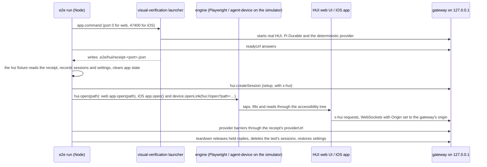

# Plan: a native iOS app for HUI, and one e2e suite for the web UI and the app

Status: a plan. Nothing in it is built yet. It was checked against `main` at `20f0c38` and against
[tester-army/e2e](https://github.com/tester-army/e2e) 0.21.2 (commit `d7c6b5e`, documented at
<https://e2e.tester.army/docs>). A statement marked "(assumption, S*n*)" is not proven yet; spike S*n* in milestone
M0 settles it before work depends on it.

## 0. Summary

- **One list of use cases, one shared test folder, two apps.** The use cases are typed data in
  `e2e/catalogue/`. The shared tests in `e2e/tests/` are tester-army/e2e `*.e2e.ts` files, each tagged with the
  IDs of the use cases it covers. One `e2e.config.ts` declares a `web` target (Playwright Chromium through
  `@e2e-dev/web`) and an `ios` target (an iPhone simulator through `@e2e-dev/mobile` and agent-device). Every test
  runs on both unless the catalogue records an approved exception. HUI writes no runner and no driver. It keeps
  one fixture file, `e2e/hui.ts`, for its gateway, test setup, the provider's barriers and the four steps whose
  gesture differs per platform.
- **The same isolated world as today.** Each target's `app.command` starts the existing
  `e2e/visual-verification.mjs` launcher: real HUI, real Pi Durable and the deterministic model provider. Shared
  tests use locator steps only, so the PR gate needs no model, no API key and no secret. Fork PRs in this public
  repository get no secrets, so that matters.
- **The code tells CI what exists.** Guard tests read the routed pages, Settings pages, Work views, tools, slash
  commands, shortcuts, transcript row kinds, settings keys, documented routes and static accessible names from the
  source. Anything no use case claims fails `npm test`. A second guard asks the library's own selection (`list()`
  from `e2e/runner`) whether every required use case runs on both targets, so a `platforms`, `requires` or `skip`
  option can't quietly drop iOS.
- **Strict lockstep, as the owner asked.** From the PR that adds the iOS job, a new or changed use case must pass
  on the web and on iOS in that same PR, and every PR runs the whole shared suite on both. Existing features start
  in a baseline that may only shrink. Until iOS catches up, a web feature in an area iOS hasn't reached has to bring
  that area's iOS screens with it, or wait.
- **A SwiftUI app.** Its transcript logic (the reducer and the chat projection) reuses HUI's own TypeScript in
  JavaScriptCore, which ships with iOS, if spike S3 shows it is fast enough. Otherwise it is ported to Swift and
  checked against fixtures the TypeScript tests write. Content that is web content already (VS Code, agent widgets,
  math, diagrams and charts, the CodeMirror editor, the GPT-Live call) runs in `WKWebView`.
- **Distribution.** CI builds an unsigned IPA for every nightly and release, with a SideStore source file beside
  it. SideStore re-signs it on the phone with the owner's free Apple ID. The app has no extensions and needs no
  paid entitlements.
- **Effort.** My estimate, not a measurement: 34 to 53 focused weeks (8 to 12 months) for one engineer working
  with coding agents to reach iPhone parity, including moving today's agent-run journeys onto the library.
  Recommendation: iPhone only. The computer already has the web UI and the Electron app.

### Decisions at a glance

| Question | Decision | Section |
|---|---|---|
| Test framework | tester-army/e2e: `e2e` 0.21.2, `@e2e-dev/web` 0.15.2, `@e2e-dev/mobile` 0.12.3, exact pins, dev dependencies | 2, 9 |
| Where use cases live | `e2e/catalogue/<area>.ts`, IDs `AREA-NNN`, a status per platform; tests point at them with `tags` | 1 |
| Targets | `web` and `ios` gate every PR; `web-phone` (WebKit at 390×844) runs nightly | 2.3 |
| Gateway and provider | The existing launcher as each target's `app.command`; setup, cleanup and barriers in one `test.extend` fixture | 2.4 |
| Agent steps | None in the gate | 2.11 |
| Retries | `retries: 0`; a flaky, skipped or missing result fails the job | 2.12 |
| Enforcement | Vitest guards on the catalogue and on `list()`, a baseline that only shrinks, required web and iOS jobs that run the whole suite | 3 |
| iOS UI | SwiftUI on iOS 18+, UIKit only where a view needs it | 4 |
| Shared logic | Transcript reducer and projection in JavaScriptCore, decided by spike S3 | 4.4 |
| Contract | The same `/__hui/` routes; the app sends `x-hui` and an `Origin`; no gateway change expected | 4.3 |
| Distribution | Unsigned IPA and SideStore source files as GitHub Release assets | 6 |
| Notifications | In-app parity (notices, unread, waiting); local notifications only for events the running app receives; no push | 4.7 |
| Telemetry | Off everywhere with `E2E_TELEMETRY_DISABLED=1`, which also stops the library's update check | 2.13, 9 |

---

## 1. Use-case catalogue

### 1.1 Format

`e2e/catalogue/<area>.ts`, one file per area, each exporting `UseCase[]`. The files are TypeScript because Node 24
and Vitest import `.ts` directly (the repo already runs `node e2e/demo/record.ts`), `npm run typecheck` checks them
once `tsconfig.json` includes them, and the status fields are type-checked. YAML would need a parser dependency,
JSON has no comments or types, and a single file would become a merge hotspot with a few hundred entries.

```ts
export type Status = "required" | "backlog" | { excluded: string; decision: string };

export type UseCase = {
  id: string;
  title: string;
  behaviour: string;
  spec: string[];
  surfaces: string[];
  journeys?: string[];
  web: Status;
  ios: Status;
};
```

| Field | Meaning |
|---|---|
| `id` | `AREA-NNN`, three digits, assigned in order, never renumbered or reused. The area matches the file name. |
| `title` | The user's goal, in the imperative: "Stop a running turn". |
| `behaviour` | What the user observes when it works, in one to three sentences, including the failure, cancel or persistence result that matters. |
| `spec` | The `SPEC.md#anchor` or `docs/api.md#anchor` that defines it. |
| `surfaces` | The code surfaces it owns, as `kind:key` strings (3.2). |
| `journeys` | The `e2e/*.browser.md` files it came from. |
| `web`, `ios` | `required`: a shared test must pass on that platform. `backlog`: an existing feature with no passing test there yet; only IDs listed in `e2e/baseline.json` may use it. An exclusion gives its reason and the `SPEC.md` heading that records the decision. |

The areas are `SHELL` (navigation, palette, loading, update notice), `SESS` (sidebar, groups, launch, menus,
split chats), `CHAT` (composer, streaming, queue, tool cards, errors, rewind, fork, compaction, commands), `RICH`
(Markdown, math, diagrams, charts, embeds, media, widgets, file links), `AGENT` (questions, secrets, subagents,
watchers, suggestions, progress, the browser and terminal tools), `WORK` (Work pane, terminal, browser view, files,
diff, VS Code), `BOARD` (Kanban, worktrees, GitHub, Jira, contributions, calendar), `SET` (Settings pages), `PAGE`
(routed pages), `BOT`, `CALL`, and `IOS` for behaviour only the app has.

Tests point at use cases through the library's `tags` option, `tags: ['CHAT-001', 'CHAT-002']`, so
`npx e2e run --tag CHAT-001` selects every test of a use case on every target.

### 1.2 How it relates to the existing documents

| Document | Role after this change |
|---|---|
| `SPEC.md` | Still the product spec. Every use case cites the section that defines it, and every exclusion cites a Decisions entry. |
| `docs/api.md` | Still the normative contract. A use case claims the routes it exercises. Routes no screen uses go into `e2e/catalogue/not-ui.ts` with a reason. |
| `e2e/*.browser.md` | Each journey gets a class in `e2e/catalogue/journeys.ts` (2.15). A journey is retired once every use case derived from it is required on the web. Journeys that judge looks stay as agent-run visual checks. |
| `.agents/skills/hui-visual-verification/references/features.md` | Maps each feature to its shared test files and tags. |

### 1.3 Building the first inventory so nothing is missed

The sources, all read from the checkout:

1. The code surfaces that the collectors in 3.2 enumerate: pages, Settings pages, navigation kinds, Work views,
   tools, slash commands, shortcuts, transcript row kinds, settings keys, `docs/api.md` routes and static accessible
   names.
2. The UI actions no collector enumerates: `src/hui-app.ts`, `src/views/home.ts`, the session row, menu and group
   modules, `src/components/` and `src/lib/session-multiplexer.ts`, including their hidden, archived, narrow, empty
   and disconnected states.
3. The 95 agent-run journeys (`e2e/*.browser.md`, 659 numbered steps). Each step becomes one or more use cases,
   then duplicates are merged.
4. `SPEC.md`: the 36 bullets of Part 1 "Behaviour", the 23 `##` sections of Part 2 and the Decisions entries. Every
   behaviour sentence maps to a use case or to an explicit "not user-visible" note. Superseded decisions and the
   features SPEC removed (approvals, agent management) stay out.
5. `docs/api.md` route headings and route tables, for behaviour no journey shows.
6. `docs/implementation-roadmap.md` (HUI-00 to HUI-21) and `docs/control-ui-coverage.md`, as a cross-check.

One research subagent per area drafts that area's file from sources 2 to 5. A second subagent re-reads SPEC and the
journeys against the draft and lists gaps. Then the guard runs, and the owner reviews the result once per area.

The completeness check has two halves. The code checks that every collected surface is claimed by a use case or
listed in `not-ui.ts` with a reason, that every journey file has a class, and that every Part 2 section and the
Part 1 "Behaviour" heading are cited. Review checks that each SPEC sentence is represented, which is what the
second-reader pass does, and PR 1 says so. Accounting for every enumerated surface does not prove that every
possible user intent is listed; 3.2 names the gaps.

### 1.4 First-pass inventory, with the commands that measured it

```bash
grep -c '^  \["' src/lib/pages.ts                                                    # 21 routed pages
sed -n '/ROUTABLE_SETTINGS_PAGES = \[/,/\]/p' src/lib/navigation.ts | grep -c '^  "' # 14 Settings pages
sed -n '/export type NavigationTarget/,/;$/p' src/lib/navigation.ts | grep -o 'kind: "[a-z]*"' | wc -l  # 6 navigation kinds
ls src/lib/work-views/*.ts | grep -vc test                                            # 5 Work views
grep -ho 'name: "[a-z_]*"' server/runtimes/*-extension.mjs | sort -u | wc -l          # 16 HUI tools
grep -o 'name: "[a-z]*"' src/lib/slash-commands.ts | sort -u | wc -l                  # 6 HUI slash commands
sed -n '/WORK_SHORTCUTS = {/,/} as const/p' src/lib/work-shortcuts.ts | grep -c '"Mod' # 7 Work pane shortcuts
sed -n '/export type ChatProjectionRow/,/;$/p' src/views/chat/projection.ts | grep -o 'kind: "[a-zA-Z]*"' | wc -l  # 6 row kinds
node --input-type=module -e 'const {DEFAULT_SETTINGS:s}=await import("./src/lib/settings.ts");const l=[];const w=(v,p)=>v&&typeof v==="object"&&!Array.isArray(v)?Object.entries(v).forEach(([k,x])=>w(x,p?p+"."+k:k)):l.push(p);w(s,"");console.log(l.length)'  # 32 settings keys
grep -oE '(GET|POST|PUT|PATCH|DELETE|HEAD)(\|[A-Z]+)* /__hui/[^` ?),]*' docs/api.md | sort -u | wc -l   # 142 method and path strings
grep -oE '^\| `/__hui/[^`]*`' docs/api.md | sort -u | wc -l                          # 22 more paths in route tables
grep -rhoE 'aria-label="[^"$]+"' src --include='*.ts' --exclude='*.test.ts' | sort -u | wc -l   # 198 static accessible names
grep -cE '^[0-9]+\. ' e2e/*.browser.md | awk -F: '{s+=$2} END{print s}'               # 659 journey steps in 95 files
awk 'NR>=460' SPEC.md | grep -c '^## '; awk 'NR>=22 && NR<460' SPEC.md | grep -c '^- ' # 23 sections, 36 bullets
```

PI's 8 built-in tools (`PI_TOOLS` in `server/runtimes/tool-catalog.ts`) come on top of the 16 HUI tools. These are
counts of evidence, not of use cases: one page holds several use cases, and one use case can cross several
modules.

The 95 journeys, grouped by file name (every file falls in exactly one group):

| Group | Journeys | Group | Journeys |
|---|---:|---|---:|
| Sessions and workspaces | 19 | Settings and resources | 9 |
| Composer, runtime and recovery | 15 | Bots and calls | 8 |
| Rendered output | 11 | Shell and interaction | 8 |
| Work tools | 9 | Integrations and operations | 4 |
| Agent controls | 8 | Installation and updates | 4 |

At the granularity of the examples below, expect a few hundred use cases: many journey steps check two or three
behaviours, and some SPEC behaviour appears in no journey. PR 1 reports the real count.

### 1.5 Example use cases

The labels are the ones the web code renders today (`src/views/home.ts`, `src/views/settings.ts`,
`src/views/kanban.ts`, `src/components/*`).

```ts
export default [
  { id: "CHAT-001", title: "Send a prompt and watch the reply stream in",
    behaviour: "Sending from Message shows the session Running and the reply growing before the turn ends; it settles to Idle with the whole reply exactly once.",
    spec: ["SPEC.md#live-chat-projection"], journeys: ["e2e/chat-composer.browser.md"],
    surfaces: ["route:POST /__hui/sessions/:id/prompt", "route:POST /__hui/sessions/:id/connect", "row:messages"],
    web: "required", ios: "required" },
  { id: "CHAT-002", title: "See a tool call as a card and open its output",
    behaviour: "A read the agent runs folds into 'Ran 1 command' once the turn settles; opening it and its 'Read <file>' card shows the file's contents and Completed.",
    spec: ["SPEC.md#live-chat-projection"], journeys: ["e2e/sdk-backend.browser.md", "e2e/chat-composer.browser.md"],
    surfaces: ["row:activity", "tool:read"], web: "required", ios: "required" },
  { id: "CHAT-003", title: "Stop a running turn",
    behaviour: "Stop ends the run: the session returns to Idle, Stop disappears and the next prompt is answered normally.",
    spec: ["SPEC.md#live-chat-projection"], journeys: ["e2e/chat-composer.browser.md"],
    surfaces: ["route:POST /__hui/sessions/:id/abort"], web: "required", ios: "required" },
  { id: "CHAT-004", title: "Steer or queue a follow-up while a turn runs",
    behaviour: "While Running, a message sent as Steer or Follow up appears as a queue row and reaches the model in that order after the current step.",
    spec: ["SPEC.md#live-chat-projection"], journeys: ["e2e/message-queue.browser.md", "e2e/steer-enqueue-fix.browser.md"],
    surfaces: ["route:POST /__hui/sessions/:id/steer", "route:POST /__hui/sessions/:id/follow-up"],
    web: "backlog", ios: "backlog" },
  { id: "CHAT-006", title: "Come back to a running turn without losing or repeating text",
    behaviour: "Reloading the page (web) or relaunching the app (iOS) mid-run shows Running and the text so far, and the reply finishes with no loss and no duplicate.",
    spec: ["SPEC.md#live-chat-projection"], journeys: ["e2e/chat-composer.browser.md", "e2e/interrupted-recovery.browser.md"],
    surfaces: ["route:GET /__hui/sessions/:id/events"], web: "backlog", ios: "backlog" },
  { id: "AGENT-001", title: "Answer the agent's structured question",
    behaviour: "One card appears above the composer and the session shows it is waiting; Submit sends every answer once and leaves a summary, and Cancel declines.",
    spec: ["SPEC.md#structured-questions"], journeys: ["e2e/ask-user-question.browser.md"],
    surfaces: ["tool:ask_user_question", "route:POST /__hui/sessions/:id/question"], web: "backlog", ios: "backlog" },
  { id: "AGENT-002", title: "Hand the agent a secret without it reaching the transcript",
    behaviour: "A masked Secret card asks for the value; Submit gives the agent a file path, and the value never appears in the transcript or the model request.",
    spec: ["SPEC.md#secret-requests"], journeys: ["e2e/secret-requests.browser.md"],
    surfaces: ["tool:secret_request"], web: "backlog", ios: "backlog" },
  { id: "RICH-001", title: "Use an agent widget in the chat",
    behaviour: "A show_widget call renders a widget whose controls work, keeps their state through a theme change and full screen, and every isolation probe of E2E_WIDGET_PROBE reports Blocked.",
    spec: ["SPEC.md#agent-widgets", "docs/api.md#agent-widgets"], journeys: ["e2e/widgets.browser.md"],
    surfaces: ["tool:show_widget", "route:GET|HEAD /__hui/widget-sandbox"], web: "backlog", ios: "backlog" },
  { id: "WORK-001", title: "Open a terminal for the conversation and run a command",
    behaviour: "A new terminal opens in the session's directory, shows it is connected, and what the operator types runs in the same shell the agent's terminal tool uses.",
    spec: ["SPEC.md#shared-terminals"], journeys: ["e2e/work-pane.browser.md", "e2e/shared-terminal.browser.md"],
    surfaces: ["work-view:terminal", "tool:terminal"], web: "backlog", ios: "backlog" },
  { id: "WORK-002", title: "Open a terminal from the keyboard",
    behaviour: "The Work pane's new-terminal chord opens a terminal tab without leaving the keyboard.",
    spec: ["SPEC.md#behaviour"], journeys: ["e2e/work-pane.browser.md"], surfaces: ["shortcut:terminal"],
    web: "backlog",
    ios: { excluded: "A keyboard-only affordance; the device engine's press takes only Enter, Space or one character, and the action has a visible control both apps test", decision: "SPEC.md#keyboard-only-affordances-stay-on-the-web" } },
  { id: "BOARD-001", title: "Move a session to another stage from its card",
    behaviour: "'Options for <title>', then Move to, then Testing moves the card to Testing and marks the stage as placed by the operator.",
    spec: ["SPEC.md#kanban"], journeys: ["e2e/kanban.browser.md"], surfaces: ["nav:kanban"], web: "backlog", ios: "backlog" },
  { id: "SESS-001", title: "Start a session in a project directory",
    behaviour: "Choosing a project directory and a first message and pressing Start session opens the new session, which answers.",
    spec: ["SPEC.md#behaviour"], journeys: ["e2e/session-launch.browser.md"],
    surfaces: ["page:new-session", "route:POST /__hui/sessions"], web: "backlog", ios: "backlog" },
  { id: "SESS-014", title: "Reposition a chat pane by dragging its header",
    behaviour: "Dropping a pane on another pane's edge or centre moves or swaps it, keeping drafts, scroll and streams.",
    spec: ["SPEC.md#behaviour"], journeys: ["e2e/pane-reposition.browser.md"], surfaces: [], web: "backlog",
    ios: { excluded: "SPEC: moving is desktop-only, like edge splitting; narrow screens keep the active-pane presentation", decision: "SPEC.md#behaviour" } },
  { id: "SET-001", title: "Choose light or dark mode",
    behaviour: "Settings, Appearance, Color mode, Dark applies at once and is still selected after a reload or relaunch.",
    spec: ["SPEC.md#behaviour"], journeys: ["e2e/miami-theme.browser.md"],
    surfaces: ["settings-page:appearance", "setting:themeMode"], web: "backlog", ios: "backlog" },
  { id: "IOS-001", title: "Connect the app to a gateway",
    behaviour: "Entering the gateway URL shows its version and the session list; a gateway older than the app supports shows a notice naming both versions.",
    spec: ["SPEC.md#native-ios-app"], surfaces: ["route:GET /__hui/update"],
    web: { excluded: "The web UI is served by its own gateway", decision: "SPEC.md#the-ios-app-connects-to-one-gateway" }, ios: "required" },
  { id: "IOS-002", title: "Get a local notification when a run finishes while the app is in the background",
    behaviour: "With notifications allowed, a run that settles or starts waiting while the app is backgrounded but still running posts a local notification that opens that session. After iOS suspends the app, the session list shows the result on return.",
    spec: ["SPEC.md#native-ios-app"], surfaces: [],
    web: { excluded: "The web UI sends no system notifications; a phone app is usually in the background", decision: "SPEC.md#ios-notifications-are-local" }, ios: "required" },
];
```

The statuses are shown as they stand after PR 4: CHAT-001 to CHAT-003 are required because PR 2 (web) and PR 4
(iOS) land their test, the worked example in 2.5. The rest start in the baseline. `SPEC.md#native-ios-app` and the
decision anchors cited by the `IOS-*` and `WORK-002` exclusions are new SPEC headings that PR 3 adds.

---

## 2. Shared e2e tests on tester-army/e2e

### 2.1 What the library does, and what stays HUI's

| Need | tester-army/e2e provides | HUI keeps or adds |
|---|---|---|
| Runner, selection, sharding, reports | `e2e run`, `--target`, `--tag`, `--shard`, `report.json`, `junit.xml`, `summary.md`, a `trace.md` per test | nothing |
| Driving the web UI | `@e2e-dev/web`: Playwright, with roles and names computed through the shadow trees Lit and Web Awesome use | nothing |
| Driving the iOS app | `@e2e-dev/mobile`: agent-device, an XCTest-based driver with its own runner | nothing |
| Locators, actions, waiting assertions | `screen.getByRole/getByLabel/getByText/getByTestId`, `tap/fill/longPress/hover/dragTo`, `expect(locator)` | nothing |
| Starting the gateway and provider | `app.command`, `readyUrl`, port `0` | `visual-verification.mjs launch` gains `--port` and `--receipt-dir` |
| Per-test setup, cleanup, provider barriers, deep links | `test.extend` | `e2e/hui.ts`, the `hui` fixture |
| Use cases, baseline, lockstep | `tags`, `platforms`, `requires`, `list()` | `e2e/catalogue/`, `e2e/baseline.json`, `scripts/use-cases.test.mjs` |
| The label and test-id contract | the query vocabulary | both apps render the same names and ids (2.7) |
| CI | documented GitHub Actions jobs | `e2e.yml`, nightly and release steps |

### 2.2 Layout

```
e2e.config.ts                  targets, the launcher command, retries 0, reporters
e2e/
  hui.ts                       the `hui` fixture: gateway, setup and cleanup, provider barriers, open, reload, peek, attach
  hui-env.ts                   the fixture world, the iOS gateway port and simulator, read from the environment
  tests/<area>/<slug>.e2e.ts   shared tests, tagged with the use-case IDs they cover
  catalogue/<area>.ts          use cases (section 1); types.ts, not-ui.ts, journeys.ts and surfaces.ts beside them
  baseline.json                { backlog: { web: ID[], ios: ID[] }, unexercisedLabels: string[] }; only shrinks
  baseline-check.ts            fails a PR that grows the baseline or changes a backlog use case without graduating it
  report-check.ts              fails a run whose report is missing or stale, or has a flaky, skipped or interrupted test
  files/                       attachment fixtures (a tiny PNG, notes.txt)
  visual-verification.mjs, pi-provider-fixture.mjs, ...   the existing fixtures, kept
  *.browser.md                 the existing journeys, retired as their use cases are automated (2.15)
```

The tests glob is `e2e/tests/**/*.e2e.ts`, so the runner never collects the demo recorder, probes or fixtures.
Vitest's `include` (`{bin,cli,desktop,evals,scripts,server,src}/**/*.test.*`) never collects `*.e2e.ts` files.
`.gitignore` gains the `.e2e/` outputs (`results/`, `cache/`, `sessions/`, `logs/`, `videos/`, `hui/`,
`report.json`, `junit.xml`, `summary.md`). HUI doesn't run `e2e init`, because it scaffolds files HUI doesn't want.

### 2.3 `e2e.config.ts`

```ts
/** The shared e2e suite: HUI's web UI in a browser and the iOS app on a simulator, each against a disposable gateway. */
import { execFileSync } from 'node:child_process';
import type { E2EConfig } from 'e2e';
import { web } from '@e2e-dev/web';
import { mobile } from '@e2e-dev/mobile';
import { IOS_GATEWAY_PORT, IOS_SIMULATOR, WORLD_FLAGS } from './e2e/hui-env.ts';

const branch = execFileSync('git', ['branch', '--show-current'], { encoding: 'utf8' }).trim() || 'HEAD';

const launcher = (target: string, port: string) => ({
  executable: 'node',
  args: ['e2e/visual-verification.mjs', 'launch', '--branch', branch, '--port', port, '--receipt-dir', '.e2e/hui', ...WORLD_FLAGS],
  inheritEnv: ['USER', 'LOGNAME', 'SHELL', 'LANG', 'LC_ALL', 'HUI_OPENVSCODE_SERVER_MIRROR'],
  startupTimeout: 120_000,
  log: `.e2e/logs/hui-${target}.log`,
});

export default {
  tests: 'e2e/tests/**/*.e2e.ts',
  retries: 0,
  workers: 1,
  failOnSkippedFailure: true,
  assertionTimeout: 15_000,
  reporters: ['list', 'junit', 'markdown'],
  targets: [
    {
      name: 'web',
      engine: web({ viewport: { width: 1440, height: 900 } }),
      app: { url: 'http://127.0.0.1:0', command: launcher('web', '{port}') },
    },
    {
      name: 'web-phone',
      engine: web({ browser: 'webkit', viewport: { width: 390, height: 844 } }),
      app: { url: 'http://127.0.0.1:0', command: launcher('web-phone', '{port}') },
    },
    {
      name: 'ios',
      engine: mobile({ platform: 'ios', ...(IOS_SIMULATOR ? { device: IOS_SIMULATOR } : {}) }),
      app: {
        bundleId: 'dev.hui.ios',
        launchArguments: ['-HUIGatewayURL', `http://127.0.0.1:${IOS_GATEWAY_PORT}`],
        permissions: { notifications: 'grant', photos: 'grant' },
        readyUrl: `http://127.0.0.1:${IOS_GATEWAY_PORT}/__hui/health`,
        command: launcher('ios', String(IOS_GATEWAY_PORT)),
      },
    },
  ],
} satisfies E2EConfig;
```

- **Why these settings.** `retries: 0` and `failOnSkippedFailure` override the CI default of one retry, for the
  reason in 2.12. `workers: 1` because the provider's barriers are global to one launcher (2.9); parallel runs come
  from `--shard`, one launcher each. `assertionTimeout` is a deadline, not a sleep: a session's first turn starts
  Pi Durable, which can take longer than the 5-second default. The default reporters write only to the terminal,
  so the config asks for `junit.xml` and `summary.md` too.
- **The web targets.** `http://127.0.0.1:0` asks the runner for a free port, which it hands to the launcher as
  `{port}`. Only the selected targets' commands start, so `--target web` starts one gateway. `web-phone` runs
  WebKit at phone size, the closest the web engine gets to Safari on an iPhone. It runs nightly and adds web
  evidence; it never stands in for the iOS target.
- **The iOS target.** A device target can't take an `app.url` yet (the library's
  [mobile reference](https://e2e.tester.army/docs/reference/mobile)), so
  its gateway listens on a fixed port from `HUI_E2E_IOS_PORT` (default 47400), with `readyUrl` as the probe. The
  simulator shares the Mac's network, so `http://127.0.0.1:47400` inside the app is the gateway on the Mac. The app
  reads `-HUIGatewayURL` the way Foundation reads any `-key value` launch argument, into `UserDefaults`, so the tests
  need no special build.
- **Deterministic config.** The runner hands its child only `PATH`, `HOME` and the temp variables, so `inheritEnv`
  passes the few variables `fixtureEnvironment` in `visual-verification.mjs` already allowlists. Every worker that
  re-imports the config reads the same branch and port, which keeps the runner's config digest stable (a random port
  in the config would fail with `CONFIG_NOT_DETERMINISTIC`).
- **No `agents` key.** The gate never needs a model (2.11).

The launcher changes are small, in `e2e/visual-verification.mjs` and `e2e/visual-verification-server.mjs`, with
`e2e/visual-verification.test.mjs` extended. `--port <n>` makes the Vite server listen on that port instead of `0`.
`--receipt-dir <dir>` removes any old `receipt-<port>.json` at start, then writes the public receipt (`url`,
`providerUrl`, `workspace`, `artifacts`, `world`, never the control token) there once the launcher is ready, the
way `save()` already writes its private receipt. `e2e/hui-env.ts` maps `HUI_E2E_WORLD` (`default`, `jira`,
`github`, `activity`, `quota`, `pi-sessions`) to the launcher's existing fixture flags and reads `HUI_E2E_IOS_PORT`
and `HUI_E2E_SIMULATOR`.

### 2.4 The `hui` fixture

Every shared test imports `test` from `e2e/hui.ts`, not from `e2e`. The fixture runs before each test and tears
down after it, failures included (the library's [test reference](https://e2e.tester.army/docs/reference/test),
"Your own fixtures").

```ts
/** HUI's fixture for the shared e2e suite: the disposable gateway each target runs against, setup and cleanup through its API, the deterministic provider's barriers, and the four steps whose gesture differs per platform. */
import { execFileSync } from 'node:child_process';
import { readFile } from 'node:fs/promises';
import { expect, test as base, type Locator } from 'e2e';
import type { Browser } from '@e2e-dev/web';
import type { Device } from '@e2e-dev/mobile';
import { IOS_GATEWAY_PORT, IOS_SIMULATOR } from './hui-env.ts';

type Receipt = { url: string; providerUrl: string; workspace: string };
type SessionList = { groups: { sessions: { id: string }[] }[] };

export type Hui = {
  workspace: string;
  api<T>(method: string, path: string, body?: unknown): Promise<T>;
  createSession(input: { title: string; group?: string }): Promise<{ id: string }>;
  provider: { held(): Promise<void>; release(): Promise<void> };
  open(path: string): Promise<void>;
  reload(): Promise<void>;
  peek(target: Locator): Promise<void>;
  attach(target: Locator, files: string[]): Promise<void>;
};

export const test = base.extend<{ hui: Hui }>({
  hui: async (fixtures, use) => {
    const web = fixtures.platform === 'web';
    const port = web ? new URL(fixtures.app.baseUrl!).port : String(IOS_GATEWAY_PORT);
    const file = `.e2e/hui/receipt-${port}.json`;
    await expect.poll(() => readFile(file).then(() => true, () => false), { timeout: 60_000 }).toBe(true);
    const receipt: Receipt = JSON.parse(await readFile(file, 'utf8'));

    const api = async <T>(method: string, path: string, body?: unknown): Promise<T> => {
      const response = await fetch(receipt.url + path, {
        method,
        headers: { 'x-hui': '1', 'content-type': 'application/json' },
        body: body === undefined ? undefined : JSON.stringify(body),
      });
      if (!response.ok) throw new Error(`${method} ${path} answered ${response.status}`);
      return (await response.json()) as T;
    };
    const control = async (method: string, path: string) => {
      const response = await fetch(receipt.providerUrl + path, { method });
      if (!response.ok) throw new Error(`provider ${path} answered ${response.status}`);
    };
    const sessionIds = async () =>
      (await api<SessionList>('GET', '/__hui/sessions')).groups.flatMap((group) => group.sessions.map((session) => session.id));
    const device = () => (fixtures as unknown as { device: Device }).device;
    const browser = () => (fixtures as unknown as { browser: Browser }).browser;

    const existing = new Set(await sessionIds());
    const settings = await api('GET', '/__hui/settings');
    await fixtures.app.clearState();

    await use({
      workspace: receipt.workspace,
      api,
      createSession: async (input) =>
        (await api<{ session: { id: string } }>('POST', '/__hui/sessions', { cwd: receipt.workspace, ...input })).session,
      provider: {
        held: () => control('GET', '/control/wait-replay-ready'),
        release: () => control('POST', '/control/release-replay'),
      },
      open: async (path) => {
        if (web) return fixtures.app.open(path);
        await fixtures.app.open();
        await device().openLink(`hui://open?path=${encodeURIComponent(path)}`);
      },
      reload: () => (web ? browser().reload() : fixtures.app.restart()),
      peek: (target) => (web ? target.hover() : target.longPress()),
      attach: async (target, files) => {
        if (web) return target.setInputFiles(files.map((name) => `e2e/files/${name}`));
        for (const name of files) execFileSync('xcrun', ['simctl', 'addmedia', IOS_SIMULATOR ?? 'booted', `e2e/files/${name}`]);
        await target.tap();
        await pickNewestPhotos(fixtures.screen, files.length);
      },
    });

    await control('POST', '/control/release-replay');
    for (const id of await sessionIds()) if (!existing.has(id)) await api('DELETE', `/__hui/sessions/${id}`);
    await api('PUT', '/__hui/settings', settings);
  },
});
```

- **Waiting for the receipt.** The runner starts the tests once the gateway answers, and the launcher may still be
  writing its receipt. Polling the file with a deadline waits on an observable condition, the same pattern as
  `until()` in `visual-verification.mjs`.
- **Isolation.** Each test starts with `app.clearState()`, which clears the browser's or the app's persisted state
  (drafts, Work pane layout, the last route) and reopens the app. Teardown releases any reply the provider still
  holds, deletes every session the test created (`DELETE /__hui/sessions/:id` also stops its runtime and terminals)
  and writes the gateway's settings back. Tests that create other gateway state (backlog items, bots, automation
  tasks) delete it through the same `api`. A test that needs a pristine gateway, such as first-run empty states,
  runs in its own world (2.9). If tests still interfere, the fallback is a fresh launcher per test on the same port,
  at a cost spike S7 measures.
- **The UI must send its own headers.** Only the fixture's setup calls carry `x-hui`. The web engine gets no extra
  `headers`, so a UI request that forgot `x-hui` still fails the test.
- **Platform branches stay in this file.** `open`, `reload`, `peek` and `attach` are the only steps whose gesture
  differs per platform, and a guard keeps `platform`, `device` and `browser` out of test files (3.1). The library
  throws only when a test reads a fixture its engine lacks, so reading `device` lazily on iOS and `browser` lazily on
  the web works (assumption, S1).
- **iOS attachments.** `setInputFiles` doesn't exist on devices, so the fixture seeds the simulator's photo library
  and picks the newest photos in the system picker. `pickNewestPhotos`, a few lines beside the fixture, gets its body
  from spike S13 (assumption, S13).

### 2.5 Worked example: send, stream, tool card, stop (CHAT-001, CHAT-002, CHAT-003)

The prompts are real triggers of `e2e/pi-provider-fixture.mjs`. `E2E_REPLAY` streams `Replay prefix — ` and holds
the rest until `POST /control/release-replay`. `E2E_RICH` streams thinking and a `read` of the workspace's
`fixture.txt` (the launcher writes `Real SDK browser fixture` into it), then a `# Tool complete` heading.
`E2E_ABORT` streams `Abort prefix` and holds until the client goes away. Any other prompt gets `Fixture response.`

```ts
/** Sending a prompt streams the reply, its folded tool card opens to its output, and Stop ends a run (CHAT-001, CHAT-002, CHAT-003). */
import { expect } from 'e2e';
import { test } from '../../hui.ts';

test('a reply streams, its tool card opens, and Stop ends the next run', { tags: ['CHAT-001', 'CHAT-002', 'CHAT-003', 'smoke'] }, async ({ app, screen, hui }) => {
  const message = screen.getByRole('textbox', 'Message');
  const send = screen.getByRole('button', 'Send message');
  const status = (value: string) => screen.getByLabel(`Session status: ${value}`);
  const transcript = screen.getByTestId('transcript');

  const session = await hui.createSession({ title: 'Stream and stop' });
  await hui.open(`/sessions/${session.id}`);
  await expect(status('Idle')).toBeVisible();

  await message.fill('E2E_REPLAY');
  await send.tap();
  await expect(status('Running')).toBeVisible();
  await hui.provider.held();
  await expect(transcript.getByText('Replay prefix —', { exact: false })).toBeVisible();
  await expect(transcript.getByText('replay suffix', { exact: false })).toBeHidden();
  await hui.provider.release();
  await expect(transcript.getByText('Replay prefix — replay suffix')).toBeVisible();
  await expect(status('Idle')).toBeVisible();

  await message.fill('E2E_RICH');
  await send.tap();
  await expect(transcript.getByText('Tool complete')).toBeVisible();
  await expect(status('Idle')).toBeVisible();
  await transcript.getByText('Ran 1 command').tap();
  await transcript.getByRole('button', 'Read fixture.txt').tap();
  await expect(transcript.getByText('Real SDK browser fixture', { exact: false })).toBeVisible();
  await expect(transcript.getByText('Completed')).toBeVisible();
  await app.screenshot('tool-card-open');

  await message.fill('E2E_ABORT');
  await send.tap();
  await expect(transcript.getByText('Abort prefix', { exact: false })).toBeVisible();
  await screen.getByRole('button', 'Stop').tap();
  await expect(status('Idle')).toBeVisible();
  await expect(screen.getByRole('button', 'Stop')).toBeHidden();
  await message.fill('Still there?');
  await send.tap();
  await expect(transcript.getByText('Fixture response.')).toBeVisible();
});
```

- **CHAT-001** is the first block. The reply's first half is visible while the provider holds the second, which
  can't be on screen yet. Once released, the whole reply shows exactly once: a positive matcher requires exactly
  one match and fails with `LOCATOR_AMBIGUOUS` on a duplicate (the library's
  [expect reference](https://e2e.tester.army/docs/reference/expect), "Strictness").
- **CHAT-002** is the second block. `Ran 1 command` comes from `activityLabel()` in `src/views/chat/projection.ts`,
  `Read fixture.txt` is the toggle's label in `src/views/chat/read-tool-card.ts`, and `Completed` is its outcome.
- **CHAT-003** is the last block. The next prompt's answer proves the session stays usable after Stop.
- **Screenshots.** `app.screenshot` leaves one picture per platform in `.e2e/results/`, which the PR description
  uses as evidence after it is uploaded (2.14).

`Idle` and `Running` come from `STATUS_TEXT` in `src/views/home.ts`, which moves into a pure module so the iOS core
uses the same strings. `Message`, `Send message` and `Stop` are today's `aria-label`s in `renderComposer`. Two web
changes come with the test, neither visible. The session status gets an element of its own named
`Session status: <status>`; today it is the tail of the header's meta line (`pi · <group> · Idle` in
`renderHeader`), so it can't be a target, and screen readers can then name it too. The transcript container gets
`data-testid="transcript"`, which scopes text queries away from the sidebar. On iOS the same names come from
`.accessibilityLabel("Session status: Idle")` and `.accessibilityIdentifier("transcript")`.

### 2.6 How it runs on each target



**Web.** `npx e2e run --target web` starts the launcher on a free port, waits for it, then gives each attempt a
fresh Playwright page at 1440×900. CI installs the browser first with
`npx @e2e-dev/web install chromium --with-deps`.

**iOS.**

1. CI builds a Release simulator app without signing:
   `xcodebuild -project ios/HUI.xcodeproj -scheme HUI -configuration Release -sdk iphonesimulator -destination 'generic/platform=iOS Simulator' -derivedDataPath ios/build`.
2. It creates a simulator on a pinned runtime, boots it by UDID and installs the app with `xcrun simctl install`,
   as the library's GitHub Actions guide does. An unpinned runtime can change the accessibility tree.
3. `npx e2e run --target ios` starts the launcher on 47400, and agent-device starts its XCTest runner on the
   simulator before the clock starts.
4. Each test's `app.clearState()` and `hui.open` relaunch `dev.hui.ios` with `-HUIGatewayURL`, then follow a `hui://`
   deep link. Between tests the app would otherwise stay where the last one left it.

**Locally.** `npm run ios:build` does steps 1 and 2 for the booted "HUI iPhone" simulator, and `npm run e2e:ios`
does step 3. `npx agent-device doctor` checks Xcode, the simulator and the runner.

### 2.7 How both apps expose the same targets

The library maps native controls onto its role vocabulary, so a query reads the same on both platforms, but only
for controls the platform has. On iOS a `StaticText` is `text`, an `ActivityIndicator` is `status`, and a role with
no native widget, such as `tooltip`, matches nothing (the library's
[screen reference](https://e2e.tester.army/docs/reference/screen), "Roles on a device", and its
[mobile reference](https://e2e.tester.army/docs/reference/mobile), "Capabilities"). So the shared vocabulary is
deliberately smaller than ARIA:

| What | Web | iOS | Shared query |
|---|---|---|---|
| A named control | `<button aria-label="Send message">` or its text | `Button("Send message")`, or `.accessibilityLabel` on an icon button | `getByRole('button', 'Send message')` |
| A text field | `aria-label` or `<label>` | `TextField` with `.accessibilityLabel("Message")` (the prompt is not a name) | `getByRole('textbox', 'Message')` |
| A switch, a segment, a list row | `role=switch`, `role=tab`, a list item | `Toggle`, a segmented `Picker`, a `List` cell | `getByRole('switch' \| 'tab' \| 'listitem', name)` |
| A named thing that isn't a control, such as a status line | `aria-label` | `.accessibilityLabel` | `getByLabel(name)` |
| Content | text | `Text` | `getByText(text)` |
| A container, or rows that names don't tell apart | `data-testid` | `.accessibilityIdentifier` | `getByTestId(id)` |

Shared tests use the roles `button`, `textbox`, `switch`, `tab` and `listitem`, and everything else goes through a
label, text or a test id. Test ids stay rare, for containers like `transcript`, because accessible names also serve
screen readers and a renamed label then fails the test the way a user would notice. Two guards hold the contract
(3.1). Spike S5 checks the SwiftUI side of the table: a multi-line `TextField` as `textbox`, `DisclosureGroup`
labels, queries scoped under a `ScrollView` identifier, and controls inside a `WKWebView`.

### 2.8 Gestures, keyboard and layout without forking tests

| Web affordance | In a shared test | iOS |
|---|---|---|
| Hover cards (session, PR, Jira badges) | `hui.peek(locator)`, which hovers on the web | long press; the preview shows the card |
| Right-click menus | the visible "Options for …" button, tapped | the same button; a long-press menu is an extra |
| Drag (Kanban) | `dragTo()` | `dragTo()`, which the device engine supports on listed controls |
| Reload mid-run | `hui.reload()`, which reloads the page | `app.restart()`, which keeps persisted state; the app reopens its last session |
| Deep link | `hui.open(path)` | `app.open()` and `device.openLink` |
| Attach files | `hui.attach(button, files)`, `setInputFiles` on the web | the seeded photo library and the system picker (S13) |
| Keyboard shortcuts, Escape to close | none; separate web-only use cases such as `WORK-002` | excluded, because the device engine's `press` takes only Enter, Space or one character. Every action a shortcut triggers also has a visible control that both apps test |
| Split chat columns, pane moving, Work pane resizing | none; use cases SPEC already calls desktop-only | excluded with that SPEC text |
| Narrow destinations (the panel selector) | a tap by name | the same destination chooser and labels |

A test asserts the use case's intent (both chats stream, the draft survives switching), not geometry. Geometry is
for screenshots and the remaining visual checks.

### 2.9 Fixture worlds, isolation and network faults

- **One world per run.** A run starts one launcher with the flags of its world (`HUI_E2E_WORLD`). Tests that need
  a non-default world carry the tags `world` and `world:<name>`. The default run uses `--exclude-tag world`; the
  Jira run is `HUI_E2E_WORLD=jira npx e2e run --target web --tag world:jira`, and the iOS job runs each world with
  `--target ios` the same way. A guard checks that every `world:<name>` tag has its run in `e2e.yml`.
- **One test at a time per launcher.** `release-replay` frees every held reply, and `wait-held` counts holds since
  the provider started, so tests sharing a launcher run one at a time. Shards run in parallel, each with its own
  launcher.
- **Network faults.** `device.setNetwork('offline')` is unsupported on iOS simulators. Reconnect tests put the
  existing `e2e/slow-link-proxy.mjs` between the app and the gateway and give it a control to drop connections, so
  both platforms see the same fault and the owner's own network never changes.

### 2.10 Synchronization without sleeps

- Locator actions and `expect(locator)` matchers wait on the screen until a deadline, and `expect.poll` waits on a
  read value. Neither is a sleep. Prefer `toBeHidden()` over `.not.toBeVisible()`: the negated form passes only
  after a full second of continuous truth.
- The provider's long-poll barriers control model timing. Tests wait on `/control/wait-replay-ready` (a reply or a
  fixture command is being held) and release with `/control/release-replay`. The fixture's own tool commands block
  on `/control/wait-command` and `/control/wait-subagent-parent`.
- `toBeHidden()` on something that could still appear means something only after a positive sync point, as in 2.5.
  `e2e/AGENTS.md` states this rule, and review checks it.
- A guard fails any file under `e2e/tests/`, or `e2e/hui.ts`, that contains `setTimeout`, `sleep(`,
  `waitForTimeout` or `delay(`.

### 2.11 Agent steps

The library's agent steps (`agent.act`, `agent.assert`, `agent.waitFor`, `agent.extract`) need a model. The PR gate
uses none of them:

- **Cost.** `assert`, `waitFor` and `extract` call the model on every run (the library's
  [caching page](https://e2e.tester.army/docs/cache)). Locator steps cost nothing.
- **Determinism.** A model can pass a check today and fail it tomorrow on the same commit. The fixture provider
  already makes the app deterministic, and locator steps keep the test deterministic too.
- **A public repository.** GitHub gives fork PRs no secrets, and the library's CI guide says to run untrusted PR
  code without keys.
- **The replay cache doesn't change this.** Recordings let `agent.act` replay without a model, but under lockstep
  most PRs change UI, a UI change misses the recording, and a miss calls the model or fails under `cache.strict`.

`e2e.config.ts` declares no `agents`, a guard fails any file under `e2e/tests/` that uses the `agent` fixture, and
the optional `ai` peer dependency isn't installed. An exploratory suite with a model is a later owner option (D9). It
would live in `e2e/agentic/` with its own config, run only on trusted commits with spending limits, and never count
as use-case coverage.

### 2.12 Retries, flakes and reports

In CI the library retries a failed test once by default, and a test that passes on the retry is reported `flaky`
with exit code 0 (the library's [config reference](https://e2e.tester.army/docs/reference/config), "retries").
That would hide a failure, which root
`AGENTS.md` forbids ("Never weaken assertions, add sleeps, or hide failures"). So:

- **No retries.** `retries: 0` in the config, `--retries 0` on every CI command, and a guard rejects a `retries`
  option in any shared test. The library's `e2e run || e2e run --last-failed` recipe isn't used.
- **The report decides, not the exit code.** Every invocation writes to a fresh `--output` directory.
  `e2e/report-check.ts` reads that `report.json` and fails the job when the report is missing or older than the run,
  when any test is `flaky`, `interrupted` or failed, or when a use-case-tagged test is `skipped`, which also catches
  a runtime `test.skip(…)` that collection can't see.
- **Flakes get fixed where the state is owned.** The nightly runs the smoke tests and the tests changed that day
  with `--repeat-each 3`. Waits never get longer to hide a race, and there is no quarantine: a flaky required test
  is fixed or its change is reverted.

### 2.13 Local commands

```bash
npx @e2e-dev/web install chromium --with-deps         # once; Playwright's Chromium for the pinned version
npx e2e telemetry disable                             # once per machine; the scripts also set E2E_TELEMETRY_DISABLED=1
npm run e2e -- --tag CHAT-001                         # web target, default world
npm run e2e -- --tag CHAT-001 --headed --trace on     # watch it and keep the trace page
npm run ios:build                                     # core bundle, Release simulator build, install on "HUI iPhone"
npm run e2e:ios -- --tag CHAT-001                     # iOS target
HUI_E2E_WORLD=jira npm run e2e:world -- --tag world:jira   # a fixture world
npx e2e list --tag CHAT-001                           # which test and target pairs run, and why any skip
npx agent-device doctor                               # Xcode, simulator and runner checks
```

`package.json` scripts, with nothing more than an environment prefix:

```json
"e2e": "E2E_TELEMETRY_DISABLED=1 e2e run --target web --exclude-tag world",
"e2e:ios": "E2E_TELEMETRY_DISABLED=1 e2e run --target ios --exclude-tag world",
"e2e:world": "E2E_TELEMETRY_DISABLED=1 e2e run --target web",
"ios:build": "node scripts/ios-build.mjs"
```

### 2.14 CI jobs, runtime and artifacts

| Job | Runner | When | Runs | Fails the PR when |
|---|---|---|---|---|
| `test` (existing `test.yml`) | ubuntu | every PR, main | `npm run typecheck`, `npm test` with the guards in `scripts/`, including the `list()` coverage guard | any guard in 3.1 fails |
| `e2e / catalogue` (new `e2e.yml`) | ubuntu | every PR, including description edits | `node e2e/baseline-check.ts origin/$GITHUB_BASE_REF`; lists new exclusions and changed backlog use cases in the job summary | the baseline grew, or a changed backlog use case didn't graduate (3.3) |
| `e2e / web` | ubuntu, sharded | every PR, main | every shared test on `web` (`--shard i/N`), then each non-default world | a test fails, or `report-check.ts` fails |
| `e2e / ios` | `macos-26`, sharded | every PR, main | Swift unit tests, the Release simulator build, a pinned simulator, every shared test on `ios` and each world | the build, a unit test or a test fails, or `report-check.ts` fails |
| Nightly (`nightly.yml`) | macOS and ubuntu | each main push | `web-phone`, `--repeat-each 3` on smoke and changed tests, `--video retain-on-failure` on iOS, the nightly IPA | blocks the nightly prerelease and its IPA |
| Release (`release.yml`) | macOS and ubuntu | approved version PR | every test on `web` and `ios`, the release IPA, the SideStore source | blocks the release |

- **Environment.** Every job sets `E2E_TELEMETRY_DISABLED: "1"` in its workflow-level `env`, which also stops the
  daily update check. No e2e job reads a secret, and no job uses `pull_request_target`.
- **The whole suite on both platforms, every PR.** Under the owner's rule a PR may not break iOS anywhere, so the
  iOS job runs every shared test, not a guessed subset. The suite starts small and grows with the catch-up; shards
  keep the job under about 25 minutes. If the macOS concurrency GitHub gives this repository can't keep up, owner
  decision D2 chooses between more shards, waiting, or selecting tests by area per PR with the full suite on main.
- **Caches.** `~/.cache/ms-playwright` for the browsers, keyed on the `@e2e-dev/web` version, and
  `~/.agent-device` for agent-device's XCTest runner, keyed on the lockfile, as the library's guide does.
  `nightly.yml` already has a `package-macos` job on `macos-latest`; the iOS jobs are new.
- **Artifacts.** The run's `--output` directory, uploaded with `if: ${{ !cancelled() }}`, one name per shard (the
  library doesn't merge shard reports). It holds `report.json`, `junit.xml`, `summary.md` (copied to
  `$GITHUB_STEP_SUMMARY`), `results/<test>/` with the trace page, screenshots and screen dumps, and
  `logs/hui-*.log`. A step also copies the launcher's own artifacts (gateway and provider logs, `provider.jsonl`)
  from its receipt. On an iOS failure a step adds the app's log
  (`xcrun simctl spawn booted log show --predicate 'subsystem == "dev.hui.ios"'`).
- **PR evidence.** The screenshots the tests take with `app.screenshot` give the PR description desktop and iPhone
  pictures from the same commit, as `.github/pull_request_template.md` asks. They are uploaded as GitHub
  attachments and never committed.
- **Runtime.** Not measured yet. Spike S7 measures the Release build, agent-device's first start and the cost per
  test on GitHub's runners; the shard counts follow from that (assumption, S7).

### 2.15 Migrating the 95 agent-run journeys

PR 1 gives every `e2e/*.browser.md` file a class in `e2e/catalogue/journeys.ts`:

| Class | Examples | What happens to it |
|---|---|---|
| `automate` | `chat-composer`, `message-queue`, `slash-commands`, `session-groups`, `kanban`, `widgets`, `work-pane`, `bots` | Its steps become use cases and shared tests in the default world. The file is deleted once every use case derived from it is required on the web; git keeps the history |
| `world:<name>` | `jira-integration` (jira), `github-integration` and `contributions` (github), `session-calendar` (activity), `providers` (quota), `sdk-backend` and `plugin-disable-sdk` (pi-sessions) | The same, in that world's run |
| `external` | `vscode-view` (a real openvscode-server), `bots-workers` (a remote worker), `remote-loading` (the slow-link proxy) | Automated where CI can supply the program (`HUI_OPENVSCODE_SERVER_MIRROR` points at a local server, and the slow-link proxy is already in `e2e/`); otherwise it stays an agent-run procedure with the gap recorded |
| `visual` | `openclaw-primary-ui-parity`, `visual-parity-2026-09-24`, the look parts of `miami-theme`, `webawesome-controls`, `font-preferences` | Stays an agent-run visual check, because it judges looks, not behaviour |
| `packaging` | `package`, `desktop-package` | Already automated by `npm run test:package`; the journey is retired |

- **Order and slices.** Journeys migrate area by area in the order of the milestones (7.3). A journey keeps its
  steps until the shared tests that replace them pass in CI, and the PR that adds those tests removes the steps
  and lists which journey checks each test replaces. This is the slice discipline of the library's
  `migrate-to-e2e` skill; its tooling expects a Playwright or Maestro suite, so it doesn't apply to HUI's prose
  journeys.
- **One record of progress.** There is no separate `MIGRATION.md`. `npm run e2e:catalogue -- --journeys` prints
  each journey's status from the catalogue's `journeys` fields and the journey classes.
- **Stale selectors.** The journeys' "Stable selectors" sections are the first draft of each area's labels, checked
  against the code first. `chat-composer.browser.md` still says **Send**, for example, while the code says
  `Send message`.

The agent-run procedure changes with it:

- `e2e/visual-verification.mjs launch|doctor|cleanup` stays. It is the launcher the e2e config runs, and agents
  still use it for manual visual checks.
- `.agents/skills/hui-visual-verification/SKILL.md` gets three steps: run the shared tests for the touched use cases
  on both platforms (`npm run e2e` and `npm run e2e:ios` with `--tag <ID>`); take the screenshots from
  `.e2e/results/` and copy them outside the checkout for upload; look at new or changed layouts with the Browser
  tool and the iPhone simulator (`xcrun simctl io booted screenshot`) and record any gap. The library writes its
  output under the project root, so the skill allows the ignored `.e2e/` directory and keeps everything else
  outside the tree. `references/features.md` maps features to test files and tags.
- `e2e/AGENTS.md` says the shared tests are HUI's E2E, and that agent-run journeys remain only for visual checks
  and recorded gaps.

---

## 3. Enforcement, now and later

### 3.1 What fails in CI, and when

The guards are Vitest files in `scripts/`, which `npm test` already collects. The coverage guard calls `list()` from
`e2e/runner`, which "collects and selects the way `e2e list` does, and stops there. No app process, engine, or
worker starts" (the library's [runner reference](https://e2e.tester.army/docs/reference/runner)). It returns one
pair per test and target with the
test's tags, the target, a `disposition` (`run`, `skip` or `filtered`) and the reason for a skip. The guard reads
the library's own answer to "does this test run on iOS?", including every `platforms`, `requires` and `skip`
option, instead of parsing test files.

| Rule | Check | Lives in | From |
|---|---|---|---|
| Every code surface is claimed by a use case or by `not-ui.ts` with a reason, and no claim is stale | collectors against `surfaces` | `scripts/use-cases.test.mjs` | PR 1 |
| Every journey has a class in `journeys.ts`; every Part 2 SPEC section is cited | file and heading scan | same | PR 1 |
| IDs are unique and well formed; `spec` and `journeys` paths and anchors exist | schema and path check | same | PR 1 |
| An exclusion has a reason and an existing `SPEC.md` heading | anchor check | same | PR 1 |
| `backlog` appears only on IDs in that platform's baseline list | set check | same | PR 1 |
| Every ID required on a platform has a test with its tag that `list()` says runs on that target | `list()` | same | PR 2 (web), PR 3 (iOS) |
| A test that `list()` skips on `web` or `ios` covers only IDs that are backlog or excluded there | `list()` | same | PR 2 |
| Every shared test has an ID tag, and every ID-shaped tag exists in the catalogue | `list()` | same | PR 2 |
| No shared test uses `agent`, sets `retries`, reads `platform`, `device` or `browser` (only `e2e/hui.ts` may), or sleeps | source scan of `e2e/tests/` | same | PR 2 |
| Roles stay within `button`, `textbox`, `switch`, `tab` and `listitem` unless every ID the test covers is web-only; every `getByTestId` id exists as `data-testid` in `src/`, and as `.accessibilityIdentifier` in `ios/` for tests that run on iOS | source scan and `list()` | same | PR 2 (web half), PR 3 (iOS half) |
| Every static accessible name in `src/` appears in a shared test or in `baseline.unexercisedLabels` | label scan | same | PR 2 |
| Every workflow job and npm script that runs `e2e` sets `E2E_TELEMETRY_DISABLED`; every `world:<name>` tag has its run | workflow and script scan | same | PR 2 |
| The baseline never grows, and a backlog use case the PR changes leaves the backlog (3.3) | diff against the base branch | `e2e / catalogue` (`e2e/baseline-check.ts`) | PR 2, PR 3 |
| The run's own report exists, and every selected test passed on its first attempt | `report.json` | `e2e/report-check.ts` in each e2e job | PR 2 |
| TypeScript unions the app mirrors match their Swift enums | literal-set compare | `scripts/ios-contract.test.mjs` | PR 3 |
| Swift modules start with a header comment; `docs/map.md` names the `ios/` directories | the existing guard, extended | `scripts/module-headers.test.mjs` | PR 3 |
| The tests pass on the web, and on iOS | `e2e / web`, `e2e / ios` | `e2e.yml` | PR 2, PR 3 |

The label rule is a tripwire, not proof of coverage. A label found in a test only shows that some test touches
that control. Its job is to make a new control impossible to add without a test that uses it, and under lockstep
that test has to pass on iOS as well. `list()` loads `e2e.config.ts` with the iOS target in it on a Linux runner;
the docs say it starts no engine, so it should work without Xcode (assumption, S4). If it needs a Mac, the coverage
rows move into the `e2e / ios` job. Both e2e jobs become required checks in branch protection (owner action, D8).

### 3.2 Detecting new surfaces from the code

`e2e/catalogue/surfaces.ts` returns `kind:key` strings. Each collector reads the module that owns the surface, and
imports it where the module loads in Node without a DOM:

| Kind | Source | How |
|---|---|---|
| `page:` | `HUI_PAGES` in `src/lib/pages.ts` | import (21) |
| `settings-page:` | `ROUTABLE_SETTINGS_PAGES` in `src/lib/navigation.ts` | import (14) |
| `nav:` | `NavigationTarget` in `src/lib/navigation.ts` | literal scan of the type (6) |
| `work-view:` | `src/lib/work-views/*.ts` | file names (5) |
| `tool:` | `shippedTools()` in `server/runtimes/tool-catalog.ts`, plus the bot tools | import (8 PI and 16 HUI tools, plus the bot tools) |
| `command:` | `HUI_COMMANDS` and `HUI_SESSION_COMMANDS` in `src/lib/slash-commands.ts` | import (6) |
| `shortcut:` | `WORK_SHORTCUTS` in `src/lib/work-shortcuts.ts`, and the palette's chord | import (7 and 1) |
| `row:` | `ChatProjectionRow` in `src/views/chat/projection.ts` | literal scan (6) |
| `setting:` | the leaves of `DEFAULT_SETTINGS` in `src/lib/settings.ts` | import and walk (32) |
| `route:` | `docs/api.md` route headings, inline `METHOD /__hui/…` strings and route-table rows | regex (142 and 22) |
| labels | `aria-label="…"` literals in `src/**/*.ts` | regex (198); must appear in a shared test, not in the catalogue |

A PR that adds a page, a Settings page, a Work view, a tool, a slash command, a shortcut, a transcript row kind, a
setting, a documented route or a labelled control fails `npm test` until a use case claims it. That use case can't
be `backlog`, because only existing features may be, so it needs a shared test that passes on both platforms in the
same PR.

The known gaps:

- A server route missing from `docs/api.md` isn't seen. The repo rule is already to update `api.md` with every
  route; `server/hui.ts` matches routes with conditions and regular expressions that can't be enumerated reliably.
- A control whose label is computed is seen only through its page or row: 160 of the 384 `aria-label=`
  occurrences in `src/` are `aria-label=${…}`. Those labels can move into `const` tables later if the owner wants
  them collected.
- A behaviour change that adds no surface, edits no catalogue entry and touches no shared test is seen only by
  review, until its use case has a web test that would fail (3.3). The PR template asks which use cases a PR
  changes.

### 3.3 Catching up existing features under strict lockstep

The owner's rule is "always the same PR": no feature PR merges unless it ships on the web and on iOS together, with
its shared test passing on both. The plan works under that rule as stated.

- **The baseline holds existing features, not new ones.** PR 1 writes every existing use case into `baseline.json`
  with web and iOS backlog; wide-only and keyboard-only use cases start excluded on iOS. They were built before the
  rule, so they are catch-up work, not feature PRs.
- **New use cases are never backlog.** From PR 2 a new use case must be required on the web. From PR 3, when the
  iOS job exists, it must be required on both, and the coverage guard and the iOS job prove it in that PR.
- **A changed use case graduates in the same PR.** A use case counts as changed when its catalogue entry changes
  (`behaviour`, `surfaces` or `spec`) or when a shared test tagged with it changes. If it is still iOS backlog,
  `baseline-check.ts` requires the same PR to take it off the iOS backlog, so the change ships on iOS with its test
  passing there. One transition doesn't count as a change, so the web catch-up stays possible: a use case may go
  from web backlog to web required in a PR that adds its first test and leaves its `behaviour` text alone.
- **A test fix that changes no behaviour.** When a PR edits a backlog use case's test without changing what it
  checks (a selector fix, a clearer wait), the author lists the ID on an `Unchanged behaviour:` line in the PR
  description. The catalogue job reads the description from the event payload, accepts only IDs it flagged, and
  prints them in its summary for the owner's review. Catalogue edits can't use that line.
- **Bug fixes.** A fix that restores an existing use case's documented behaviour changes no catalogue entry and no
  test, so it may stay web-only while that use case is in the baseline. A fix that changes the behaviour text or the
  test is a change, and graduates.
- **What strictness costs.** Until iOS reaches parity, a web feature in an area iOS hasn't built has to build the iOS
  screens it sits on in the same PR, or wait. A new bot routine option, for example, needs the iOS Bots and Routines
  screens. In practice that pauses web feature work in areas iOS hasn't reached. The plan keeps the pause short in
  three ways. The milestones catch up the busiest areas first: of the last 100 commits, 31 touched chat files in
  `src/`, 25 session files, 17 Settings files, 17 bot files, 12 Work view files and 5 Kanban, Jira or GitHub files
  (`git log -100 --name-only`, classified by path). The iOS core reuses the web's transcript logic (4.4), so a
  change there costs nothing extra on iOS. And the milestone order is published, so the owner can see in advance
  which areas a web feature would pull in.
- **The order inside a catch-up milestone.** First the area's shared tests turn required on the web, which needs no
  iOS work and gives the web regression tests early. While the area is iOS backlog its tests carry
  `platforms: ['web']`, which the guard allows only for backlog or excluded IDs. Then the iOS screens land, the
  `platforms` option goes, and the area's IDs leave the baseline. The catalogue job reports the shrinking count.

### 3.4 Declaring a platform-specific behaviour

- **iOS doesn't do something the web does.** `ios: { excluded, decision }`, where `decision` is an existing
  `SPEC.md` heading: text that already calls the behaviour desktop-only (pane moving, edge splitting), the
  keyboard-only decision PR 3 adds, or a new Decisions entry added in the same PR. The test then carries
  `platforms: ['web']`, the owner reviews the SPEC text, and the catalogue job lists every new exclusion in its
  summary.
- **iOS-only behaviour** (connecting to a gateway, local notifications, relaunch restoring the last session) gets
  `IOS-*` IDs with `web: { excluded, decision }`, under the same rule, and tests with `platforms: ['ios']`.
- **Rare by design.** Three kinds cover every exclusion foreseen here: layouts SPEC calls desktop-only,
  keyboard-only affordances, and installation (section 5).
- **No lesser tests.** When a spike shows the app can't do something yet, the use case stays iOS backlog, which also
  blocks features that change it, until the app can, or the owner records an exclusion in SPEC. A test that checks a
  widget's container instead of the controls inside it, or shows TeX source instead of rendered math, doesn't count.

---

## 4. iOS app architecture

### 4.1 Where the code lives and how it builds

```
ios/
  AGENTS.md                  Swift rules, the core boundary, contract mirrors, no extensions or entitlements
  HUI.xcodeproj              committed, with folder-synchronized groups, so adding a file doesn't touch it
  HUI/App/                   entry, AppRoute (parsed by the core's resolveNavigation), scene phase, notifications
  HUI/Gateway/               GatewayClient (x-hui, deadlines), the SSE reader, SessionSocket, Contract/*.swift
  HUI/Core/                  HUICore.swift (the JavaScriptCore host) and the view-model types it decodes
  HUI/Chat|Sessions|Work|Kanban|Settings|Pages|Bots|Calls/   features
  HUI/Rendering/             Markdown token renderer, RichBlockRenderer, WidgetView, MediaViewer, EmbeddedWeb
  HUI/Resources/Generated/   hui-core.js and embedded/, from npm run build:ios (git-ignored)
  HUITests/                  Swift unit tests: the core bridge, SSE framing, reconnects, decoding
  core/entry.ts              what the JavaScriptCore bundle exports
  embedded/entry.ts          the WKWebView bundle: rich-block renderer, CodeMirror editor, widget host, call engine
```

`npm run build:ios` runs Vite, which `scripts/build.mjs` already uses for the web build. `ios/core/entry.ts`
builds as an IIFE library, and `ios/embedded/entry.ts` as a small page using the same `katex`, `mermaid`, `vega`,
`vega-lite` and `@codemirror/*` versions the web ships. Then `xcodebuild` builds the app. An Xcode build phase fails
with "run npm run build:ios" when the generated files are missing or stale (it compares a content hash). There is
no UI-test target: agent-device brings its own XCTest runner, so the shared tests need only a Release simulator
build. CI pins the Xcode version, and `ios/AGENTS.md` records it.

### 4.2 Target and frameworks

- iOS 18.0 minimum, for Observation (`@Observable`), `ScrollPosition`, `PhotosPicker` and `NavigationSplitView`.
  The owner's iPhone version is checked in the prerequisites; changing the minimum early is cheap.
- Swift 6 language mode with strict concurrency.
- SwiftUI throughout. UIKit through `UIViewRepresentable` only for `WKWebView`, SwiftTerm's `TerminalView`, and the
  composer's text view if SwiftUI's falls short on paste and attachments.
- `NavigationSplitView`, which collapses to a stack on the iPhone (sessions, then the chat) and becomes a sidebar on
  an iPad, if that is wanted later.

### 4.3 Speaking the `/__hui/` contract

| Concern | How |
|---|---|
| Headers | Every request, attachment and media fetches included, goes through one client that sends `x-hui: 1`. Deadlines follow `src/lib/gateway-request.ts`. Error bodies keep their status and message. |
| Gateway-wide SSE | `GET /__hui/sessions/events` (and `GET /__hui/bots/events`) over `URLSession.bytes(for:)`. The reader handles multi-byte characters split across chunks, multi-line `data:`, CRLF and heartbeat comments, then hands each frame to the core's `decodeSseFrame`. The first frame is a snapshot; a session absent from it is idle. |
| Session stream | `POST /__hui/sessions/:id/connect` returns a relative `url`. The app resolves it against the gateway, switches the scheme to `ws` or `wss`, and connects at once with `URLSessionWebSocketTask` and an `Origin` header equal to the gateway's own origin, because the upgrade requires an `Origin` whose host and port equal `Host` (`validTerminalOrigin` in `server/terminal-transport.ts`) (assumption, S2; the fallback is `NWProtocolWebSocket` with additional headers). Frames are `{event, data}` per `docs/api.md`. If URLSession doesn't offer permessage-deflate, the server sends plain frames. |
| Terminals and the browser view | `POST …/terminals/:id/connect` and `…/browser/connect`, with the same ticket and Origin flow. Binary PTY frames and JSON control frames per `shared/terminal-stream.ts` and `shared/browser.ts`. Terminal input is disabled while disconnected, never buffered for later. |
| Tickets | One use, 15 seconds: minted right before each connect, never cached. 429 means retry later; close code 4404 means the session was deleted. |
| Reconnects | Backoff from the core's `reconnectDelay(attempt)`. Every reconnect mints a new ticket, and the snapshot replaces local state. `NWPathMonitor` and the scene becoming active trigger reconnects. Going to the background closes sockets cleanly, since iOS would suspend them anyway; runs continue on the gateway. |
| Late answers | Each request and stream carries a generation number, so a late response never overwrites a newer selection or a newer snapshot. |
| Request ids | The core's `SendRequests` (`src/lib/send-requests.ts`), with Swift supplying `UUID().uuidString`, so a resend reuses its id exactly as the web does. Drafts and request ids are keyed by gateway and session, so switching gateways never sends an old draft to another session. There is no offline outbox: an ambiguous send shows a retry that reuses the id. |
| Versions | `GET /__hui/update` gives the gateway's running version. The app knows the oldest gateway version it supports, its own release unless a later gateway change says otherwise. An older gateway gets a notice naming both versions and blocks sending; a newer one gets a notice and keeps working; a development gateway with no version is shown as unverified. A gateway change that breaks older apps ships with the app update in the same release, which lockstep makes the normal case. |

No gateway change is expected for any of this. `docs/api.md` gains a short "Native clients" section saying what a
client outside a browser must send.

### 4.4 Shared logic: a small JavaScriptCore core

`ios/core/entry.ts` re-exports pure functions the web already uses, and the build bundles them into `hui-core.js`,
which `HUICore.swift` loads into a `JSContext`. JavaScriptCore is a system framework, not a dependency. The point is
lockstep: logic the core shares is written once, so a change to it lands on both apps in the same PR at no extra
cost, and the labels the chat shows come from the same code.

The core starts small and grows only when a screen needs a function:

- the transcript reducer (`reduceTranscript`, `normalizeTranscript`, `appendPendingUser`, `settlePendingUser` in
  `src/lib/transcript-state.ts`) and the projection (`projectChatTranscript`, `activityLabel`, `workingLabel` in
  `src/views/chat/projection.ts`), which carry the subtle rules: `historyRefreshed: false` keeps the live
  projection, a tool update applies to the latest matching id, and `turn_end` alone doesn't unlock the composer;
- `SendRequests`, `reconnectDelay` and `decodeSseFrame`, after moving the last two out of
  `src/lib/sessions-store.ts` into their own module so the bundle doesn't pull in the store;
- `resolveNavigation` and `navigationPath` (`src/lib/navigation.ts`);
- later, when their screens land: the Markdown parser half of `src/lib/markdown.ts`, the slash-command and
  file-reference parsers, diff hunks, `parseTerminalControlFrame`, and the `shared/*` normalizers.

The web side gets small refactors with no behaviour change: `src/lib/markdown.ts` splits into a parser half
(markdown-it and its plugins, returning tokens) and a Lit rendering half, and `STATUS_TEXT` moves into a pure
module. A Vitest test loads the built bundle in `node:vm` with an empty global object and calls every export, so a
DOM, `fetch`, timer, `navigator` or `requestAnimationFrame` dependency fails `npm test`. Swift supplies ids and the
clock. The core keeps in-memory state per session and returns only changed rows, keyed by stable ids. Swift owns
all I/O, lifecycle and UI.

One `JSContext` runs on a dedicated serial executor, and stream events are coalesced to at most one core call per
display frame. Spike S3 measures load time, bundle size, and reduce-plus-project time on the 2 MB conversation from
`e2e/long-session-fixture.ts` at streaming rates, on the simulator and on the owner's iPhone. If S3 fails, the
reducer and projection are ported to Swift instead, and the existing Vitest tests write JSON conformance fixtures
(events in, rows out) that Swift tests replay, so the two implementations can't drift silently.

### 4.5 Keeping Swift types in sync with `shared/` and `docs/api.md`

1. Payloads the core normalizes are decoded from the core's output, so the TypeScript normalizer stays the only
   validator and Swift mirrors only the view models.
2. One mirror file per source, `ios/HUI/Gateway/Contract/<name>.swift`, whose header names its source (for example
   "Mirrors shared/terminal-stream.ts and docs/api.md 'Shared terminal API and tool'").
3. `scripts/ios-contract.test.mjs`, which runs on Linux, compares the string literals of listed TypeScript unions
   with the matching Swift `enum …: String` cases: `ChatProjectionRow` kinds, `TranscriptItem` kinds, session
   statuses, `NavigationTarget` kinds, Work view kinds, session-stream event names, terminal control frames and
   `ROUTABLE_SETTINGS_PAGES`. A new row kind or status fails `npm test` until Swift handles it.
4. Swift unit tests decode real responses recorded from the fixture gateway (sessions, snapshots, events, settings,
   errors, a large transcript, an unknown future event), and a decode failure logged during an e2e run fails the
   test.

Generating Swift from TypeScript is left out: HUI's wire types use conditional and `Extract<>` types that
generators handle badly, and the core plus the union guard catch the drift that matters with less machinery.

### 4.6 State

| Store (`@Observable`) | Mirrors | Holds |
|---|---|---|
| `GatewayModel` | `settings-store`, `update-store` | URL, version, connection state, settings |
| `SessionList` | the session list in `sessions-store` and the status SSE | groups, sessions, status, unread, background |
| `SessionModel`, one per open session | `subscribeSession` | socket, the core's transcript handle, rows, status, queue, questions, model, usage, thinking |
| `WorkModel`, per conversation | `src/lib/work-pane.ts` | open views and the active view, kept on the device as the web keeps them in the browser |
| Feature stores | `files-store`, `diff-store`, `terminals-store`, `browser-store`, `vscode-store`, `tools-store`, `theme-store` | per feature |

The transcript is a `ScrollView` and `LazyVStack` keyed by the core's row ids and anchored at the bottom. Drafts and
the Work pane state live on the device, as they live in the browser on the web (`docs/api.md`, "Browser-owned
composer drafts" and "Browser-owned Work pane"). UI errors go to `POST /__hui/diagnostics/ui-errors`, as the web's
do.

### 4.7 The hard surfaces

| Surface | Web today | iOS approach | Spike |
|---|---|---|---|
| Markdown | `src/lib/markdown*.ts` (markdown-it, CJK, task lists, file references, Slack, GitHub and X rules) | The core returns markdown-it tokens with the same plugins and rules. Swift renders them: `AttributedString` for inline text, views for blocks, tables as a `Grid` in a horizontal scroll | none |
| KaTeX, Mermaid, Vega-Lite | the npm packages | `RichBlockRenderer`: one offscreen `WKWebView` loads the embedded bundle (same versions) and returns images and SVG, cached by source, theme and width, shown as native images with the source as accessibility label. A tap opens the media viewer (zoom, save, copy SVG) | S8 |
| Code highlighting | lezer through `src/lib/code-languages.ts` | The core tokenizes; Swift colours an `AttributedString` | S3 |
| Tool cards | `src/views/chat/*-tool-card.ts`, `src/views/home.ts` | One SwiftUI view per card kind (read, command, codemode, generic, watcher activity, task suggestion, progress, browser preview); unknown extension tools get the generic card with bounded JSON and text | none |
| Terminals | Gespenst over a WebSocket | SwiftTerm's `TerminalView`, fed the binary frames, sending input and resize JSON. The key bar is an input accessory with the "Terminal keys" labels. Both apps expose the visible screen as the terminal's accessible value (a small web change), so tests read terminal text the same way | S2, S5 |
| Managed browser view | `src/components/browser-pane.ts`, view-only frames | `shared/browser.ts` frames decoded into an `Image`, a tab picker, the follow toggle and the click-mark overlay. It shows the gateway's Chromium; it isn't a browser on the phone | none |
| Files | tree, search, CodeMirror | A native tree, search, upload (`fileImporter`), delete and image preview. The editor is CodeMirror from the embedded bundle in a `WKWebView`; saves and version conflicts go through native calls to the files routes, with their `ETag` and `If-Match` contract | none |
| Diff | `src/lib/diff-hunks.ts`, `src/lib/diff-highlight.ts` | The core parses and highlights; SwiftUI renders unified, and side by side when the width rule in SPEC "Diff" allows it (landscape) | none |
| VS Code | a proxied web app in a frame | A `WKWebView` loads the `url` from `POST /__hui/sessions/:id/vscode/connect`, a `/__hui/vscode/enter?ticket=…` redirect that sets the proxy's cookie in that web view's data store. Licence consent and provider settings are native | S5 |
| Agent widgets | an opaque-origin sandbox iframe | A `WKWebView` host page, loaded with the gateway origin as `baseURL`, frames the gateway's own `/__hui/widget-sandbox` and speaks the same frame protocol (`docs/api.md`, "Frame protocol"). The web view uses its own non-persistent `WKWebsiteDataStore` and gets no `x-hui`. Swift accepts host messages only from the host page's main frame (`frameInfo.isMainFrame` and its security origin), only of the protocol's kinds and sizes, and opens a link only for a credential-free http(s) URL after a user tap. `E2E_WIDGET_PROBE` must report every probe blocked on iOS too | S9 |
| Attachments | file input, paste, drop | `PhotosPicker`, `fileImporter`, the camera and paste, with the server's limits (8 files, 12 MB each, 16 MB in total; `server/hui.ts`) checked before sending | S13 |
| Presented media | img, video, audio and the viewer | `AsyncImage` (media URLs carry a random id and need no `x-hui`), `AVPlayer` and QuickLook, with native zoom and pan and the share sheet to save | none |
| Voice calls (Labs) | WebRTC in the browser (`src/lib/live-call*.ts`) | A `WKWebView` call engine runs the same `live-call.ts` and `live-call-platform.ts` from the embedded bundle, with native call controls over a message bridge. It needs the microphone permission and a secure context (HTTPS or loopback), as browsers do. A call that iOS suspends ends with a notice and its record | S10 |
| Notifications | in-app notices (`role=status` and `alert`), unread and waiting indicators; no system notifications | The same in-app behaviour. The iOS-only extra (IOS-002): local notifications through `UNUserNotificationCenter` for settled and waiting sessions the app sees while it runs or right after it is backgrounded. Nothing is promised after iOS suspends the app; the list shows the result on return. Push would need APNs, which free accounts don't get, or a relay (owner decision D4) | S12 |
| Kanban drag and drop | HTML drag, "Options for X", then Move to | Columns in a horizontal scroll, `.draggable` and `.dropDestination`, and the same menu | S5 |
| Settings (14) and pages (21) | Lit forms | A SwiftUI `Form` or `List` per page with the same labels; usage charts in Swift Charts, a system framework | none |
| Command palette | a dialog | A search sheet opened from a visible control; ⌘K with a hardware keyboard | none |
| Themes and fonts | `themes/*.json`, `src/styles/tokens.css`, `public/fonts` | Theme JSON from the gateway mapped to SwiftUI colours; the same font files bundled and registered | none |
| Bot faces | `src/lib/bot-face.ts` | State from the core, drawn with SwiftUI `Canvas` and `TimelineView` | none |
| Split chats | columns on desktop, the active pane below 1100 px | The narrow behaviour: one chat visible, the others stay connected, drafts survive switching | none |
| Downloads (bot export, diagnostics) | a browser download | `fileExporter` or the share sheet | none |
| "Open in a new tab" (memory page) | a new browser tab on the same origin | An in-app `WKWebView` whose request sends `x-hui`, because the memory page requires it or a same-origin fetch (`server/hui.ts`); Safari would get neither | none |

### 4.8 Reachability and security

- **Phone to gateway: nothing new.** The recommended setup is `tailscale serve` with its `ts.net` name in
  `allowHosts` (`docs/guide.md`, "Remote access through a reverse proxy"). That is HTTPS with a valid certificate,
  which App Transport Security accepts without exceptions, and the secure context calls need. The Tailscale app on
  the phone provides the route.
- **App Transport Security.** The app sets `NSAllowsLocalNetworking`, which the simulator tests need for
  `http://127.0.0.1` and which allows nothing beyond local hosts. Plain HTTP to the tailnet address
  (`hui gateway start --host tailnet`) works only if ATS allows it (assumption, S11). If it doesn't, the app
  supports HTTPS only for remote gateways, which is owner decision D13; there is no blanket ATS exception.
- **No new authentication.** The app reaches exactly what the phone's Safari reaches today, with the same `x-hui`,
  Host and Origin checks. Anyone who can reach the gateway over the tailnet can operate it, as today; the tailnet ACL
  is the boundary. The app stores only gateway URLs and its own drafts. Secrets typed into a secret request go to the
  gateway and are never persisted or logged. Authentication would be a product change for the whole gateway (owner
  decision D5), not part of this work.
- **Embedded web views** navigate only within the gateway origin (and the sandbox page for widgets). Other links open
  in Safari. The `JSContext` has no network, file or timer APIs.
- **No extensions, no entitlements.** No share or widget extension, App Groups, Associated Domains or push, which
  suits free-account signing (section 6). The `hui://` URL scheme needs none.

---

## 5. Capability matrix

N = native SwiftUI, E = embedded web view, A = adapted to the phone, X = excluded.

| Web capability area | iOS | Notes |
|---|---|---|
| Sidebar, session list, status, unread, background | N | |
| Search, filter and sort, groups, group Git defaults | N | |
| New session (directory picker, worktree, branch, checkout) | N | |
| Session menus: rename, icon, move, archive, delete, fork | N | The visible options buttons, as on the web; a long-press menu is an iOS extra |
| Hovercards (session, PR, Jira) | A | Long-press preview |
| Command palette | N | Opened from a visible search control |
| Keyboard shortcuts: Work pane chords, ⌘K, Escape to close | X | Keyboard-only affordances (a SPEC decision PR 3 adds); every action they trigger has a visible control both apps test |
| Composer, send modes, drafts, queue, steer, follow-up | N | |
| Streaming, thinking, metrics, copy, reply, rewind, fork, compaction | N | Projection from the core |
| Slash commands, skill and plugin commands, path autocomplete | N | Parsing from the core |
| Tool cards | N | |
| Questions and secret requests | N | The secret field is a `SecureField` |
| Subagents, steering, tree collapse, delivery | N | |
| Markdown, tables, code, file links, Slack, GitHub and X embeds | N | The X embed after consent, in a small `WKWebView`, as the web loads X's widget |
| Math, Mermaid, Vega-Lite | E and N | Rendered by the same libraries offscreen, shown as native images |
| Agent widgets | E | The gateway's sandbox page, the same protocol |
| Presented media and the media viewer | N | |
| Attachments | N | System photo and file pickers (S13) |
| Split chats (the multiplexer) | A | The narrow behaviour SPEC describes |
| Pane drag repositioning, edge splitting, Work pane resize | X | SPEC: desktop-only |
| Work pane tabs, launchers, narrow destination | A | One view at a time, as in the web's narrow layout |
| Shared terminal | N | SwiftTerm |
| Managed browser view | N | |
| Files | N and E | Native tree, CodeMirror editor |
| Diff | N | |
| VS Code | E | A web app on both platforms |
| Kanban (stages, drag, options, backlog start) | N | |
| Worktrees settings, PR badges, GitHub login, Jira create and link | N | |
| Contributions and calendar | N | Swift Charts and a native grid |
| Settings: appearance, gateway and power, integrations, workers, models and providers, plugins, skills, tools, memory, automation, privacy, sessions, worktrees, diagnostics | N | Power settings control the Mac that runs the gateway |
| Pages: about, activity, config, contributions, connection, cron, debug, labs, logs, memory import, model providers, model setup, new session, plugin(s), profile, sessions, skill workshop, skills, tasks, usage | N | |
| Gateway update (`/update` and the update dialog) | N | Updates the gateway; the app itself updates through SideStore |
| Bots (Labs): roster, chat, soul, tools, routines, triggers, templates, export, faces, workers | N | Export through the share sheet |
| GPT-Live calls (Labs) | E | Call engine in `WKWebView`, native controls |
| Notices, run errors, interrupted recovery, slow-link loading | N | |
| "Open in a new tab" (VS Code, memory page) | A | VS Code opens in Safari at the same gateway URL; the memory page opens in an in-app web view (4.7) |
| Desktop app (Electron) and package install | X | Not a UI capability; `npm run test:package` covers it |

The only exclusions are behaviour SPEC already calls desktop-only, keyboard-only affordances, and installation.

---

## 6. Distribution through SideStore

| Item | Plan |
|---|---|
| Build | CI runs `xcodebuild archive -scheme HUI -sdk iphoneos -destination 'generic/platform=iOS' CODE_SIGNING_ALLOWED=NO MARKETING_VERSION=<x.y.z> CURRENT_PROJECT_VERSION=<number>`, then zips `Payload/HUI.app` into `HUI-<version>.ipa`. SideStore re-signs it on the phone with the owner's free Apple ID (assumption, S6). If SideStore refuses an unsigned IPA, CI ad-hoc signs it. A simulator `.app` can't be sideloaded |
| Versions | `CFBundleShortVersionString` is the package's `x.y.z`. `CFBundleVersion` is a number that only grows, the commit timestamp `scripts/nightly-version.mjs` already computes. The full HUI version, `-nightly.<stamp>.g<sha>` included, goes in an `HUIVersion` Info.plist key for the version check |
| Source feeds | `scripts/sidestore-source.mjs` writes `sidestore-source.json` (name, bundle id, icon, versions with `downloadURL`, `size`, `minOSVersion`, date and changelog). Stable: a release asset at `releases/latest/download/sidestore-source.json`. Nightly: an asset of the rolling `nightly` prerelease at `releases/download/nightly/sidestore-source.json`. The owner adds one or both sources in SideStore (assumption, S6, which checks the schema against SideStore's docs) |
| Release coupling | `release.yml` builds the IPA from the same validated commit as the `.tgz`, after the full suite on both platforms, and attaches it to the same GitHub Release with the same changelog. `nightly.yml` does the same for the nightly. The repository is public, so these files are public, which is fine because the app holds no secrets (owner decision D6) |
| App IDs and slots | One app with no extensions, so one app ID and one bundle id for both channels. Free accounts allow a small number of active sideloaded apps, SideStore included, and a weekly budget of app IDs (assumption, S6, checked on the phone); every extension would cost another |
| 7-day signing | SideStore refreshes the signature before it expires. A missed refresh means the app won't open until SideStore refreshes it; its data is kept. `docs/guide.md` will say so |
| SideStore and Tailscale | SideStore installs and refreshes through its own on-device VPN, and iOS runs one VPN at a time, so Tailscale may have to be off during an install or refresh (assumption, S6). The app shows the gateway as unreachable meanwhile and reconnects when Tailscale is back. The tested sequence goes in `docs/guide.md` |
| Bundle id | `dev.hui.ios` in the project, which the e2e iOS target uses. SideStore may rewrite it for free accounts (assumption, S6); that affects only the phone, not the simulator CI uses, and nothing depends on the bundle id at runtime |
| Gateway and app versions | The gateway updates through `hui update`, the app through SideStore, so they can differ for a while. The policy in 4.3 decides what the app does then |

---

## 7. Roadmap

### 7.1 Prerequisites

1. **Xcode and a simulator** on the owner's Mac, which has only the command line tools today: install Xcode, accept
   the licence (`sudo xcodebuild -license accept`, run in the shared terminal), run `xcodebuild -runFirstLaunch`, add
   the iOS simulator runtime (`xcodebuild -downloadPlatform iOS`), and create the simulator with
   `xcrun simctl create "HUI iPhone" <iPhone type> <pinned runtime>`.
2. **The library's tooling**, once PR 2 installs the packages: `npx @e2e-dev/web install chromium --with-deps`,
   `npx agent-device doctor`, `npx e2e telemetry disable`.
3. **Node 24.8 or later.** The e2e packages need it (`^22.22.3 || >=24.8.0`). The owner's machine has 24.14.1, and
   CI's `node-version: "24"` resolves to the newest 24.x.
4. **The phone.** Check its iOS version (18 or later) and that SideStore has a free app slot.
5. **Reachability.** `tailscale serve` for the gateway with its name in `allowHosts`, if that isn't set up already.
6. **GitHub.** Check the macOS runner concurrency for the account. Later, make `e2e / web` and `e2e / ios` required
   checks.
7. **The owner's approvals** (section 11), the dependencies first.

### 7.2 Milestone M0: spikes (a throwaway branch, no PR)

| Spike | Question | If it fails |
|---|---|---|
| S1 | Does the launcher run as `app.command` (with `{port}`, `inheritEnv`, `readyUrl`, and on the iOS target without a `url`), and can a `test.extend` fixture read `device` only on iOS and `browser` only on the web? | CI starts the launcher before `e2e run`, and the targets point at it; `hui.open` on iOS navigates through visible controls |
| S2 | Does `URLSessionWebSocketTask` send a custom `Origin` that passes `validTerminalOrigin`? | `NWProtocolWebSocket` with additional headers |
| S3 | JavaScriptCore core: bundle size, load time, reduce and project on the 2 MB fixture at streaming rate, on the simulator and the iPhone | Port the reducer and projection to Swift, checked by conformance fixtures (4.4) |
| S4 | Does `list()` from `e2e/runner` load the config with the iOS target on a Linux runner? | The coverage rows run in the `e2e / ios` job |
| S5 | Does agent-device, on the `macos-26` runner, read a SwiftUI Release build as 2.7 assumes (a multi-line `TextField` as `textbox`, `DisclosureGroup` labels, queries scoped under a `ScrollView` identifier, controls inside a `WKWebView` for VS Code, widgets and the editor), and do `longPress`, `dragTo` and `device.openLink('hui://…')` work? | Adjust the contract table and add test ids where names don't reach. Where the controls inside a web view can't be reached, the use case stays iOS backlog until production accessibility or an upstream engine fix reaches them |
| S6 | Does SideStore install an unsigned (or ad-hoc signed) CI IPA and read the source feed, with the URL scheme working after re-signing? What are the slot and app-ID budgets, and how do SideStore's VPN and Tailscale share the phone? | Ad-hoc signing; document the VPN sequence the phone needs |
| S7 | On GitHub's runners: Release simulator build time, agent-device's first start, cost per test on both targets, macOS concurrency, and the cost of a fresh launcher per test | Shard counts; owner decision D2 |
| S8 | Rich-block renderer: image quality and memory; inline math baseline alignment in SwiftUI `Text` | Another rendering approach for the affected blocks; the use cases stay iOS backlog meanwhile |
| S9 | Widget host: does the gateway's sandbox page accept a `WKWebView` host loaded with the gateway `baseURL`, do the main-frame and origin checks hold, and does agent-device reach the controls inside the widget? | A static same-origin widget host route on the gateway that frames the unchanged sandbox, as a `docs/api.md` change; the widget use cases stay iOS backlog until it passes |
| S10 | (before M11) Call engine: `getUserMedia` and `RTCPeerConnection` in `WKWebView` against GPT-Live | A native WebRTC framework (dependency 5) |
| S11 | App Transport Security: loopback HTTP, the tailnet address over HTTP, the `ts.net` name over HTTPS | HTTPS only for remote gateways (owner decision D13) |
| S12 | Local notifications under free signing | Notifications only while the app is in the foreground |
| S13 | Can agent-device pick seeded photos in `PhotosPicker` and a file in `fileImporter`? | Owner decision D10: one test-only launch argument that lists `e2e/files` in the app's own picker sheet |
| S14 | With `E2E_TELEMETRY_DISABLED=1`, does anything still call out (`E2E_TELEMETRY_DEBUG=1` prints what would be sent)? Does agent-device send telemetry of its own? | Set agent-device's own opt-out in the same places, or report it to the owner before PR 3 |

S1, S4 and S14 gate PR 2. S2, S3, S5, S6, S7 and S13 gate milestones M3 and M4. S8 and S9 gate M6, S10 gates
M11, and S11 and S12 gate their features.

### 7.3 Milestones

Each milestone ships a usable slice. Its done-check is always the same: every ID of its areas is required on both
platforms and green in the nightly, `baseline.json` lost those IDs, the journeys whose use cases are all automated
are deleted, and the owner installs the nightly IPA through SideStore and uses the slice.

| # | Slice | Areas | Ships |
|---|---|---|---|
| M1 | Catalogue and guards | all (inventory, journey classes) | PR 1 |
| M2 | Shared tests on the web with tester-army/e2e | CHAT-001 to 003, SESS-001, SET-001, then the web catch-up starts | PR 2 |
| M3 | iOS skeleton: connect, the live session list, the iOS target, lockstep switched on, the IPA through SideStore | IOS, SESS (session list) | PR 3, PR 5 |
| M4 | Chat: open, stream, tool cards, Stop, queue, attachments, errors, relaunch recovery, slash commands, model and thinking pickers, Markdown | CHAT | PR 4 and the next ones |
| M5 | Sessions and navigation: new session, groups, search, menus, palette, split-chat narrow behaviour | SESS, SHELL | |
| M6 | Agent interactions and rich content: questions, secrets, subagents, watchers, suggestions, progress, widgets, media, math, diagrams, charts, embeds | AGENT, RICH | |
| M7 | Bots (Labs), among the most active areas | BOT | |
| M8 | Settings and pages | SET, PAGE | |
| M9 | Work views: terminal, browser view, files, diff, VS Code | WORK | |
| M10 | Integrations: Kanban, worktrees, GitHub, Jira, contributions, calendar (worlds `jira`, `github`, `activity`) | BOARD | |
| M11 | Calls (Labs) | CALL | |

In every milestone the area's web tests land first and its iOS screens second, so the web gains automated coverage
early and the window in which a behaviour change can slip past the tests (3.2) closes area by area. The web
catch-up can run ahead of iOS, because it needs no iOS work. PR 5 depends only on PR 3, so it can land before PR 4 if
the owner wants the skeleton on the phone sooner.

### 7.4 The first five PRs

**PR 1: `test: add the use-case catalogue and a guard that finds uncatalogued surfaces`**

- Adds `e2e/catalogue/*.ts` with the full first inventory (drafted per area by subagents and checked by a
  second-reader pass), `types.ts`, `not-ui.ts`, `journeys.ts` and `surfaces.ts` beside it, `e2e/baseline.json`,
  `scripts/use-cases.test.mjs` with the PR 1 rows of 3.1, a `docs/map.md` row, and `tsconfig.json` including
  `e2e/catalogue`. No new dependency yet; the rows that need `list()` arrive with the library in PR 2.
- `SPEC.md` gets a decision "Use cases live in one catalogue", plus Decisions entries for any exclusion.
- Verified by `npm test -- scripts/use-cases.test.mjs` and `npm run typecheck`, and by three deliberate local
  breakages that the guard must name before they are reverted: a new `HUI_PAGES` row, a new HUI tool and a new
  setting. The PR reports the use-case count and the journey classes.

**PR 2: `test: run the shared e2e tests on the web with tester-army/e2e`**

- Adds `e2e@0.21.2`, `@e2e-dev/web@0.15.2` and `@e2e-dev/mobile@0.12.3` as exact dev dependencies, with
  `package-lock.json`. The mobile package comes now so the lockfile changes once; PR 3 starts using it.
- Adds `e2e.config.ts` with the `web` and `web-phone` targets, `e2e/hui.ts`, `e2e/hui-env.ts`, and the launcher's
  `--port` and `--receipt-dir`, with `e2e/visual-verification.test.mjs` extended.
- Adds the worked example `e2e/tests/chat/send-stream-tool-stop.e2e.ts`, plus `e2e/tests/sess/start-session.e2e.ts`
  (SESS-001) and `e2e/tests/set/color-mode.e2e.ts` (SET-001), and the two invisible web changes: the session status
  element named `Session status: <status>`, and `data-testid="transcript"`.
- Adds the PR 2 rows of 3.1 (the `list()` rows, no `agent`, no `retries`, no sleeps, roles, the web half of the
  test-id rule, the label tripwire, telemetry, worlds), `e2e/report-check.ts`, `e2e/baseline-check.ts`, `e2e.yml`
  with the `catalogue` and `web` jobs, the `e2e` and `e2e:world` scripts and the `.gitignore` entries.
- Updates `e2e/AGENTS.md` and `CONTRIBUTING.md` (Node 24.8+ for contributors, the browser install, telemetry off).
- Verified by spikes S1, S4 and S14; the CI web job green and a local `npm run e2e`; renaming "Stop" locally fails
  CHAT-003 with `trace.md`, a screenshot and the screen dump in `.e2e/results/`; adding `{ retries: 2 }`, a
  `setTimeout` or `platforms: ['web']` to the worked example fails the guard (the last because CHAT-001 isn't
  web-only); adding a labelled button fails the label tripwire; `npm ci --ignore-scripts` on a clean checkout (the
  Lockfile workflow); and `E2E_TELEMETRY_DEBUG=1 npm run e2e` printing nothing to send.

**PR 3: `feat: add the iOS app skeleton and run the shared tests on an iPhone simulator`**

- Adds `ios/` with the project and `ios/AGENTS.md`; `HUICore` with a first core of `resolveNavigation`,
  `decodeSseFrame` and session-list normalization (after moving those pure helpers out of
  `src/lib/sessions-store.ts`); a Connect screen; the version check; the live session list from `/__hui/sessions`
  and `/__hui/sessions/events`; the `hui://` scheme; and `HUITests`.
- Adds `npm run build:ios`, `npm run ios:build` and `npm run e2e:ios`, the `ios` target in `e2e.config.ts`, the
  `e2e / ios` job (pinned simulator, Release build, `~/.agent-device` cache), `scripts/ios-contract.test.mjs`
  (statuses and navigation kinds), module headers for `ios/` and `.swift`, and the iOS half of the test-id rule.
- IOS-001 and the session-list use cases are required on both. CHAT-001 to 003 are iOS backlog for now, so the worked
  example carries `platforms: ['web']`, which the guard allows only because they are backlog. From this PR on, new
  and changed use cases must pass on both platforms.
- Docs: the lockstep rule in root `AGENTS.md`, `CONTRIBUTING.md`, the PR template's iOS section and its
  `Unchanged behaviour:` line, the visual-verification skill's new steps, `docs/api.md` "Native clients", and
  `SPEC.md` "Native iOS app" with its decisions (lockstep, the JavaScriptCore core, SideStore, local notifications,
  keyboard-only affordances).
- Verified by both e2e jobs green and the Swift unit tests (`xcodebuild test -only-testing:HUITests`); simulator
  screenshots from `.e2e/results/` in the PR; a scratch commit adding a baseline entry failing `e2e / catalogue`; a
  scratch use case marked required without an iOS-passing test failing the coverage guard; and a scratch edit to a
  backlog use case's test failing `e2e / catalogue` until its ID is graduated or listed as unchanged.

**PR 4: `feat: chat on iOS: open a session, stream replies, tool cards, Stop`**

- Adds the session WebSocket with tickets, `Origin` and reconnects; the core's transcript reducer, projection,
  `SendRequests` and Markdown tokens (with the `markdown.ts` parser split and the `STATUS_TEXT` move on the web
  side); the composer, Send and Stop; read, command, codemode and generic tool cards; the basic Markdown renderer;
  and `.accessibilityLabel("Session status: …")` and `.accessibilityIdentifier("transcript")`.
- The worked example loses `platforms: ['web']`, and CHAT-001 to 003 leave the iOS baseline, so it runs on both.
- Verified by the e2e jobs on both targets, the S3 numbers in the PR description, screenshots from both targets, and
  the core's `node:vm` boundary test.

**PR 5: `ci: build the iOS app for SideStore with every nightly and release`**

- Adds the archive and IPA steps to `nightly.yml` and `release.yml` after the full suite on both targets,
  `scripts/sidestore-source.mjs` with its unit test, and the install steps in `docs/guide.md` and the README.
- Verified by a nightly run publishing `HUI-<version>.ipa` and `sidestore-source.json`; the owner adding the source in
  SideStore, installing, connecting over `tailscale serve` and seeing the live session list (spike S6 confirmed on
  the phone); and `npx vitest run scripts/sidestore-source.test.mjs`.

---

## 8. Effort

These numbers are my judgment, not measurements. They assume one engineer comfortable with SwiftUI, working full
time with coding agents, and they count focused weeks. Re-estimate after M4 from the measured rate of use cases
turned required per week.

| Work | Estimate |
|---|---|
| M0 prerequisites and spikes | 1 to 2 weeks |
| M1 catalogue and guards | 1 to 2 weeks |
| M2 tester-army/e2e setup, the `hui` fixture, launcher flags, first tests, CI | 1 week |
| M3 iOS skeleton, the iOS target and CI, SideStore | 2 weeks |
| M4 chat | 3 to 5 weeks |
| M5 sessions and navigation | 3 to 4 weeks |
| M6 agent interactions and rich content | 4 to 6 weeks |
| M7 bots | 4 to 6 weeks |
| M8 Settings and pages | 4 to 6 weeks |
| M9 Work views | 4 to 6 weeks |
| M10 integrations | 2 to 3 weeks |
| M11 calls | 1 to 2 weeks |
| Moving the existing journeys onto shared web tests, spread over M2 to M11 | 4 to 8 weeks |
| Upgrading a pre-1.0 library over that period | about half a day per upgrade |
| **iPhone parity in total** | **about 34 to 53 weeks, roughly 8 to 12 months** |

- **What the library changed.** M2 and M3 don't build a runner, a web driver or an XCUITest bridge, which saves one
  to two weeks; upgrades cost a little in return. The rest of the estimate is the iOS app itself.
- **The ongoing cost of lockstep.** After parity, a feature with new UI pays for its iOS screens, and its one shared
  test already runs on both targets. A typical UI feature costs roughly 30 to 80% more than web-only work; features
  heavy on media, permissions or layout can cost double. A change to logic the core shares costs nothing extra on
  iOS, and a gateway-only change still needs both apps' tests to pass.
- **The cost of strictness before parity.** A web feature in an area iOS hasn't reached carries that area's iOS
  screens with it. That changes when the work lands, not how much there is: the same screens would be built in the
  area's milestone anyway.

**iPhone and computer.** The computer already has the web UI and the Electron app (`desktop/`), and both are in the
shared suite through the `web` target, so iPhone plus the computer costs nothing beyond the estimate above. A native
Mac app adds no capability. If the owner wants one anyway, a Catalyst or "Designed for iPad" route costs about 6 to
10 more weeks (windows, menus, pointer and keyboard, file handling, packaging), and a separate macOS SwiftUI target
more like 10 to 16. The bigger cost is testing: the library's mobile engine drives iOS and Android, not macOS apps,
so under lockstep every PR would need a third way to run the shared tests, at a cost nobody knows yet. Running the
iPhone app on an Apple Silicon Mac from Xcode costs nothing as an experiment (assumption: it works with a free
personal team).

**iPad.** `NavigationSplitView` and the web's own narrow and wide rules make the iPad mostly layout work: split
chats, the Work pane beside the chat, pointer hover and the keyboard. About 3 weeks for a scaled-up iPhone layout and
up to 10 for split chats and the Work pane, plus an `ipad` target (one more `mobile({ platform: 'ios', device:
'iPad …' })` entry) whose run every PR would pay for.

**Recommendation.** iPhone only until M6, then decide on iPad on its own merits. Leave the Mac to the web UI and
Electron.

---

## 9. Dependencies for approval

| # | Package or tool | Exact pin | Replaces | Why it's worth it | Licence | Alternative without it |
|---|---|---|---|---|---|---|
| 1 | `e2e` (runner, CLI, SDK) | `0.21.2` | a home-grown runner | The owner chose it. Tests, selection, tags, sharding, reports, traces, and `list()` for the guards | Apache-2.0 | a home-grown runner |
| 2 | `@e2e-dev/web` | `0.15.2` (pins `playwright-core` 1.64.1) | a CDP driver of HUI's own | Roles and names through shadow DOM, waiting actions, Chromium and WebKit | Apache-2.0 | the in-repo CDP client (`server/browser/cdp.ts`) with the demo Director's finder |
| 3 | `@e2e-dev/mobile` | `0.12.3` (pins `agent-device` 0.21.28, MIT, by Callstack) | an XCUITest bridge of HUI's own | Drives the simulator through accessibility with the web's query API | Apache-2.0 | an XCUITest bridge |
| 4 | SwiftTerm (Swift package), at M9 | the latest release then, pinned by `Package.resolved` | writing a terminal emulator, or Gespenst in a web view | A mature native terminal view fed directly by HUI's binary PTY frames | MIT | Gespenst (`@gespenst/core`, already a dependency) in a `WKWebView` |
| 5 | A WebRTC framework (for example `stasel/WebRTC`), only if S10 fails | pinned then | WebRTC in `WKWebView` | A native `RTCPeerConnection` | BSD-3-Clause | the `WKWebView` call engine (preferred) |
| 6 | Playwright's Chromium and WebKit builds (a download, not a package) | the builds `playwright-core` 1.64.1 names | the system Chrome | The web engine runs the browser its Playwright was tested with | Chromium BSD-style, WebKit LGPL and BSD | `web({ connect })` to a Chrome HUI starts itself (`server/browser/`), which loses WebKit |
| later | `ai` and one AI SDK provider | approved separately | | Only for the optional exploratory suite (D9); the gate doesn't install it | Apache-2.0 | no exploratory suite |

- **Pre-1.0 risk.** The library is three months old (created 2026-07-22), changes daily, and its README says APIs and
  config can change between minor releases. In return: exact pins; one grouped Dependabot update for the three
  packages (`.github/dependabot.yml` exists); every upgrade runs the full suite on both targets before it merges;
  platform-specific API use stays in `e2e/hui.ts`; and the Apache-2.0 licence allows a fork if the project stalls.
  The tests are plain TypeScript with a Playwright-like API, which keeps a way out.
- **What gets installed.** The three packages have no install scripts, so `npm ci --ignore-scripts` keeps working.
  Their dependency tree is not small (`@modelcontextprotocol/server`, `oxc-parser` and `oxc-transform` with native
  binaries, `@vitest/expect`, `@clack/prompts`, `commander`, `zod` and more). All of it is dev-only and pinned by the
  lockfile, and none of it ships in HUI's `.tgz`, because `files` in `package.json` lists only `bin/`, `build/`,
  `dist/` and `desktop/`. The fonts and npm assets bundled into the IPA (KaTeX, Mermaid, Vega, CodeMirror) need a
  licence screen in the app's About page, from `THIRD_PARTY_NOTICES.md`.
- **The Node engine.** The packages need Node `^22.22.3 || >=24.8.0`, and HUI's `engines.node` is `>=24.0.0`. Dev
  dependencies never reach users who install HUI, so `engines.node` stays, and `CONTRIBUTING.md` states 24.8+ for
  contributors. Raising `engines.node` to `>=24.8.0` instead is owner decision D11.
- **The browser download.** `npx @e2e-dev/web install chromium --with-deps` (and `webkit`) fetches the builds from
  Playwright's CDN once per machine, and CI caches `~/.cache/ms-playwright`.
- **Telemetry off everywhere.** The CLI sends anonymous usage data and runs a daily update check by default (the
  library's [telemetry page](https://e2e.tester.army/docs/telemetry)). `E2E_TELEMETRY_DISABLED=1` turns both off. It is set in every workflow's `env` and
  every `package.json` script that calls `e2e`, a guard checks both (3.1), and contributors run
  `npx e2e telemetry disable` once. S14 checks agent-device for telemetry of its own.

Considered and rejected: Appium with WebdriverIO, Maestro, Playwright Test directly, XcodeGen or Tuist, MarkdownUI
or swift-markdown (a different parser than markdown-it), SwiftMath, Runestone (a different editor than the web's
CodeMirror), and Swift code generation with quicktype, ts-json-schema-generator or TypeBox schemas.

---

## 10. Repository changes beyond code

| File | Change |
|---|---|
| `AGENTS.md` (root) | Architecture: the iOS client in `ios/` uses the same `/__hui/` contract and shares its transcript logic with the web through the core. Validation: `npm run e2e` and `npm run e2e:ios`. Change discipline: every user-visible change ships with its use case and a shared test passing on the web and iOS in the same PR, with no sleeps and no retries. Fix "The repository is private" (`gh` reports it public; the owner confirms) |
| `e2e/AGENTS.md` | Rewritten: the shared tests in `e2e/tests/` are HUI's E2E; the catalogue, tag and baseline rules; the label and test-id contract; no agent steps in the gate; the ignored `.e2e/` output; journeys remain only for visual checks and recorded gaps |
| `ios/AGENTS.md` (new) | Swift conventions and header comments, the core boundary, mirror files, the accessible names and identifiers the web uses, no extensions or entitlements, how to build for the simulator and run `npm run e2e:ios` |
| `src/AGENTS.md` | Accessible names and the few test ids are a contract both apps keep; logic the core bundles stays free of the DOM (the `node:vm` test checks it) |
| `server/AGENTS.md` | A route change updates the iOS client in the same PR; native clients send `Origin` |
| `docs/api.md` | "Native clients": what a client outside a browser sends, and the version policy |
| `docs/map.md` | An `ios/` section (app, core, embedded, tests), and `e2e/tests/`, `e2e/catalogue/` and `e2e.config.ts` under `e2e/` |
| `SPEC.md` | Part 2 "Native iOS app"; Decisions: one catalogue and shared tests in lockstep; the shared tests run on tester-army/e2e; a JavaScriptCore core; SideStore distribution; iOS notifications are local; keyboard-only affordances stay on the web; any other exclusion |
| `docs/implementation-roadmap.md` | HUI-22 "Native iOS app", M0 to M11 |
| `docs/guide.md`, `README.md` | Installing through SideStore, connecting over `tailscale serve`, the 7-day refresh, the VPN sequence |
| `CONTRIBUTING.md` | Node 24.8+, Xcode setup, the browser install, telemetry off, the iOS loop, `npm run e2e` and `npm run e2e:ios`, releasing the IPA, the lockstep rule |
| `.github/pull_request_template.md` | "Use cases" (IDs added or changed) and the `Unchanged behaviour:` line; e2e results per target; screenshots for desktop and iPhone from `.e2e/results/`, uploaded, never committed |
| `.agents/skills/hui-visual-verification/` | The three steps in 2.15; features mapped to test files and tags |
| `.github/workflows/` | `e2e.yml` (new: catalogue, web, ios); `nightly.yml` and `release.yml` gain the iOS and `web-phone` runs and the IPA; every e2e job sets `E2E_TELEMETRY_DISABLED` |
| `.github/dependabot.yml` | One group for `e2e`, `@e2e-dev/web` and `@e2e-dev/mobile` |
| `scripts/` | `use-cases.test.mjs`, `ios-contract.test.mjs`, `ios-build.mjs`, `sidestore-source.mjs` and its test; `module-headers.test.mjs` covers `ios/` and `.swift`; `build.mjs` builds the iOS bundles |
| `e2e.config.ts`, `package.json`, `package-lock.json`, `tsconfig.json`, `.gitignore` | The config; three dev dependencies and the `e2e`, `e2e:world`, `e2e:ios`, `ios:build` and `build:ios` scripts; `tsconfig.json` includes `e2e.config.ts`, `e2e/hui*.ts`, `e2e/tests`, `e2e/catalogue`, `ios/core` and `ios/embedded`; ignore the `.e2e/` outputs, `ios/HUI/Resources/Generated/`, `ios/build/`, `DerivedData` and `*.xcresult` |

No persisted gateway format changes. If an implementation PR changes one anyway, it follows `CONTRIBUTING.md` and
ships a `hui doctor` check.

---

## 11. Risks, assumptions and owner decisions

### Risks

| Risk | Likelihood, impact | Mitigation |
|---|---|---|
| Strict lockstep pauses web feature work in areas iOS hasn't reached | high, high | Catch up the busiest areas first; the core makes transcript-logic changes free on iOS; the milestone order is public |
| tester-army/e2e is pre-1.0; a minor release breaks an API or the config | high, medium | Exact pins, grouped upgrades that run the full suite, platform-specific API use kept in `e2e/hui.ts`, Apache-2.0 fork as a last resort |
| agent-device's iOS runner wedges, or reads a SwiftUI control differently from the contract | medium, high | S5 on the real runner image; a pinned simulator runtime; the library's recovery steps (`agent-device daemon stop`, reboot by UDID) in the job; test ids where names don't reach |
| The JavaScriptCore core is too slow on long transcripts or awkward to debug | medium, medium | S3 gate; a protocol that returns only changed rows; the Swift port with conformance fixtures as the fallback |
| The full iOS suite on every PR is too slow for macOS runner capacity | medium, high | S7 measures; shards; owner decision D2 |
| Tests sharing one launcher interfere with each other | medium, medium | `clearState`, teardown that deletes what a test created, worlds for pristine state; a fresh launcher per test if needed (S7 prices it) |
| System pickers can't be driven, so attachments can't pass on iOS | medium, medium | S13; owner decision D10 for the one test-only seam |
| SideStore or free-account limits differ from what is assumed, or its VPN and Tailscale clash | medium, high | S6 on the owner's phone before M3; no extensions or entitlements by design |
| The bigger dev-dependency tree adds supply-chain risk | medium, medium | Dev-only, no install scripts, lockfile pins, Dependabot, CodeQL already runs |
| The catalogue misses computed labels, undocumented routes or changes to features with no web test yet | medium, low | The gaps listed in 3.2; web tests land first in every milestone; review and the PR template's "Use cases" section |
| The effort estimate is wrong | high, medium | Re-estimate after M4 from the measured rate |

### Assumptions (each has a spike or a check)

- The library: the launcher works as `app.command`, including on a device target with no `url`, and project
  fixtures can read `device` and `browser` lazily (S1); `list()` runs on Linux with the iOS target configured (S4);
  agent-device reads SwiftUI and web-view controls as the contract assumes (S5); the system pickers can be driven
  (S13); one variable turns telemetry off (S14).
- The phone: iOS 18 or later; SideStore installs an unsigned or ad-hoc signed IPA and reads the source feed; the
  slot and app-ID budgets allow one more app; Tailscale and SideStore's VPN can take turns (S6).
- Apple and networking: `URLSessionWebSocketTask` can set `Origin` (S2); ATS allows loopback HTTP, and `ts.net`
  HTTPS needs no exceptions (S11); `WKWebView` supports `getUserMedia` and `RTCPeerConnection` (S10).
- GitHub: macOS runners for this public repository cost nothing and allow enough concurrency (S7).

### Owner decisions

| # | Decision | Recommendation |
|---|---|---|
| D1 | Approve the dependencies in section 9: the three e2e packages and the browser download now, SwiftTerm at M9, WebRTC only after S10 | Approve |
| D2 | If the full iOS suite per PR outgrows the runners: more shards, waiting, or selecting tests by area per PR with the full suite on main (which weakens lockstep) | More shards first |
| D3 | Accept a shared JavaScriptCore core for the transcript logic inside a native app (the UI is native, that logic is shared) | Accept, gated by S3 |
| D4 | Real push notifications through a third-party relay such as ntfy | Not now; local notifications only |
| D5 | Gateway authentication | Not part of this work |
| D6 | A public IPA and source feed on GitHub Releases | Accept |
| D7 | iPad and Mac targets | Not now; decide on iPad after M6 |
| D8 | Make `e2e / web` and `e2e / ios` required checks | Yes: the web from PR 2, iOS from PR 3 |
| D9 | An optional exploratory suite with a model key (`ai` and one provider), never gating | Later, if wanted |
| D10 | If S13 fails, one test-only launch argument that lists `e2e/files` in the app's own picker | Accept only if S13 fails |
| D11 | Raise `engines.node` to `>=24.8.0`, or keep `>=24.0.0` for users and state 24.8+ for contributors | Keep it, and state it for contributors |
| D12 | Keyboard-only affordances (Work pane chords, ⌘K, Escape to close) are web-only on the iPhone | Accept; every action they trigger has a tested visible control |
| D13 | If ATS blocks plain HTTP to the tailnet address, support only HTTPS (`tailscale serve`) for remote gateways | Accept |

---

## 12. Deliberately left out

- **A home-grown runner, web driver or XCUITest bridge.** The library replaces all three.
- **Agent steps in the gate, and a committed replay cache.** See 2.11; the optional suite is D9.
- **A quarantine for flaky tests.** A flaky required test is fixed or its change reverted (2.12).
- **Selecting iOS tests per PR.** Every PR runs the whole suite on both platforms until D2 says otherwise.
- **Library features with no need yet:** `e2e explore`, bug bash, the MCP server, `@e2e-dev/github` PR comments
  (`summary.md` goes to the job summary), hosted devices and browsers, video on every run.
- **New gateway authentication, APNs push, a push relay, background refresh.** Parity doesn't need them; D4 and D5.
- **App extensions** (share sheet, home-screen widgets, Live Activities) and **App Intents or Siri.** Each extension
  costs a free-account app ID, and the web has none of these.
- **Generating Swift types from TypeScript.** The core and the union guard cover drift with less machinery (4.5).
- **Pixel parity between the web and iOS.** Shared tests check behaviour; looks go in PR screenshots and the remaining
  visual journeys.
- **A separate `MIGRATION.md`.** The catalogue's `journeys` fields and journey classes record migration progress.
- **Offline transcripts or caching beyond what the web does.** The web keeps none either.
- **iPad, Mac and Android.** See section 8. The library's Android engine would make Android cheaper later, but nobody
  asked for it.
