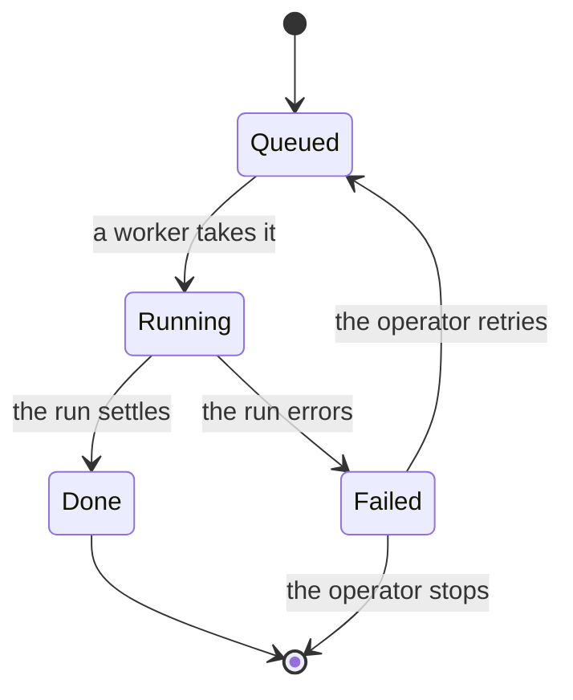

# Statechart

Draw the states a system can be in and the events that move it. The chart is a claim about the code, so every arrow needs a caller, a handler, or a stored transition. Name states in the reader's words, not in variable names.

Use when a behavior has states and events: a run lifecycle, a queue, a connection, a trigger, or a bug that is a path through states. A flow with no state is a diagram of calls, not a statechart.

## Draw

1. List the states from the code, then merge states that behave the same and split states that break different rules. Keep every state on a bug path separate.
2. Label each arrow with the event, in the reader's words. Put a condition in brackets, such as `retry [while the lease is held]`.
3. Mark the start, each terminal state, and each state that breaks a rule. Keep it under roughly 20 arrows; a chart nobody can read proves nothing.
4. Cite the code beside the chart, one `file:line` per state or transition. The chart carries the shape; the code carries the proof.
5. Check reachability. Every state is reachable from the start, and every state with a way out has one drawn. An unreachable state is a defect or a missing transition; say which.

Write it as a Mermaid state chart in a `mermaid` block. HUI renders it.

`statechart` is the artifact; `stateDiagram-v2` is the syntax. Do not paste an image unless the operator asks.

## Model check, only when asked

When the operator asks for proof, back the chart with TLA+ and TLC.

1. Work in a scratch directory outside the repository.
2. Write `Spec.tla` and its config. Give the model a variable for each fact a rule needs, one action for each event on the chart, and each rule as an `INVARIANT`. Bound the model so that TLC terminates.
3. Run TLC with a small constant set, for example `java -cp tla2tools.jar tlc2.TLC Spec`, and keep its output.
4. Report the shortest path from a start state to each state, leading with every state where a rule breaks. One line per step, in the chart's words, then the code path each step maps to.
5. Map every step back to the code. If the code does not reproduce the path, say whether the model or the code is wrong, and why.

If TLC is not installed, say so and hand back the chart with the code evidence and the gap named. Do not invent a counterexample.

## Hand off

Give the chart, the rules it claims, the states that break them, the code evidence, and what the chart or model leaves out. When the chart and the code disagree, fix the chart or file the code bug. Never adjust the chart to look right.
